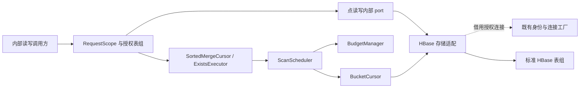

# M1 存储、扫描与预算设计

**状态：待设计评审** · **日期：2026-10-30** · **需求基线：** [DEVELOPMENT_PLAN.md v0.9](https://github.com/Reidddddd/etcd-hbase/blob/eecc95e4885d4a7cecdc37e8e406501f8d380e64/DEVELOPMENT_PLAN.md)

> 本文定义 J10–J19 的存储编码、适配、扫描、资源和扩展装配契约。沿用已批准的 [M0 设计](2026-10-10-m0-engineering-environment-protocol-design.md)；设计获批后从 J10 开始实现。具体执行步骤、命令和个人恢复记录由独立实施计划维护。

标记约定：**事实**来自上述代码/需求基线；**已确认要求**沿用主计划；**提议**需本轮设计评审确认；**待输入**不能由公开原型结果代填。本文中的组件和格式除明确列为事实者外，均是待实现的设计，不代表已通过测试。

## 1. 背景、目标与现状

M1 为后续 etcd KV、事务、历史读取和恢复提供字节模型、HBase 访问与有界扫描基础。它需要回答：任意 key 如何保序编码，两种历史布局如何比较，多桶如何正确分页，以及取消、错误和资源不足时由谁结束工作。

**事实：** 基线已包含 J00–J08 的公开工程交付：Java 21、固定 etcd v3.5.23 proto、协议骨架、HBase 身份与连接适配、盐/候选表配置、RequestScope、Go 原生对照工具及 SPI 契约。ByteKey、KeyRange、RowKeyCodec、存储 proto 和 M1 扫描调度尚未交付。J09 的公开交付工作单独评审，不作为本文已合并代码的事实来源。

**已确认要求：** HBase 保存业务权威状态；endpoint 绑定独立表组，rowkey 不增加集群路由 ID。输入 key/value 是原始字节；目录前缀不附加 Milvus 业务解释。通用 SPI 保持 JDK-only，内部存储 port 留在 core。

M0 的目标身份、权限、TLS、目标盐及发行输入仍须按各自证据验收。已有公开前置允许推进 M1 的编码与临时环境验证；不能据此关闭 M0，也不能把公开候选写成目标集群支持承诺。

## 2. 范围与阶段边界

**表 1　M1 设计覆盖范围**

| 任务 | 本阶段交付契约 |
|---|---|
| J10 | 不可变字节模型、范围、候选 rowkey 与内部存储序列化，提供独立测试向量 |
| J11 | Get/Put/单行 CAS/批量访问、分桶访问及两种历史布局的物理原型 |
| J12 | BucketCursor 的有限页、暂停、恢复、取消与清理 |
| J13 | ScanScheduler、BudgetManager、分层准入和公平调度 |
| J14 | 按原始 key 归并、全局 Limit/More 及既定轻量 Count |
| J15 | 元数据投影与真实存在性查询，避免读取无关 value |
| J16 | 缓存/合并的最小接口和无缓存路径；启用条件单独保留 |
| J17 | 冻结合成数据集、扫描基准和 HBase 操作放大报告 |
| J18 | 公开默认 provider、配置和盐 profile 的实际装配 |
| J19 | 显式 provider 选择、发现与生命周期、打包后的示例扩展契约 |

M1 不交付全局 revision 分配、多行提交、fencing、跨副本 ReadView/GC、完整 Auth 会话或生产恢复；这些继续由 M2 及后续任务负责。M1 的内部原型不启用生产 KV/Range 成功 handler，未实现 RPC 继续返回 `UNIMPLEMENTED`。

J11 比较物理布局并形成证据；J24.1 结合 J20、J52.1 选择布局与提交收尾方案，J25 验证一致读和历史视图，M2 共同冻结。一次原生 Cell 多版本读写成功不构成选型结论。

## 3. 架构与所有权〔提议〕

**表 2　组件边界与权威状态**

| 所属模块 | 职责与状态 owner |
|---|---|
| core | ByteKey/KeyRange、逻辑记录与投影、内部存储 port、游标/归并、调度和预算；不暴露 HBase Result/Scan 或存储 protobuf 类型 |
| hbase | RowKeyCodec、存储 proto/生成物、官方 client 适配、分桶物理范围与页恢复位置；执行 core 契约，不判断全局提交是否成功 |
| spi / hbase.api | 复用盐/身份契约及 HBase 专属连接边界；内部游标、预算和可见性模型不升级成公共 SPI |
| server / admin | 组装 provider 与配置，持有服务资源；校验表组格式/profile；不复制编码或扫描算法 |
| testkit | 共用逻辑契约、冻结数据集和故障时序；真实 HBase 与内存参考模型分别提供证据 |

连接由既有 HBaseConnectionFactory 持有，身份上下文由签发 provider 持有。请求只借用连接，拥有自己的操作、游标、页缓冲及预算 lease。RequestScope 继续作为请求终止的权威入口；新增组件向它注册幂等清理，不另建脱离 scope 的取消标志体系。

逻辑游标与物理 scanner 分开：逻辑游标可以存在到整个请求结束；物理 scanner 仅服务一个有限页。预算随资源所有权转移，不能因 future 已对调用方完成就提前释放仍在使用的资源。

## 4. 字节与范围模型〔提议〕

### 4.1 ByteKey

ByteKey 使用无符号逐字节字典序；相同前缀下短数组在前。构造和导出可变数组时防御复制，equals/hashCode 与内容比较一致，禁止 String/字符集转换参与排序。`toString` 不输出完整业务 key。

模型允许空字节串以表达内部边界；某个业务 RPC 是否接受空 key 由协议层校验，不把空串等同于 null、无穷或不存在。编码/解码先检查长度与整数运算，超上限返回明确错误，不截断 key。

### 4.2 KeyRange

范围使用带类型的上下界和包含性；点查、空范围、无界范围分别表达。常规范围规范化为 `[start, end)`，精确 key 保留点查形态，不靠追加零字节模拟下一 key。上游 `range_end` 特殊值只在协议边界转换，core 不以魔法 byte[] 表示无穷。[etcd Range 定义](https://github.com/etcd-io/etcd/blob/v3.5.23/api/etcdserverpb/rpc.proto)

前缀结束位置从末尾寻找非 `ff` 字节，加一并截断后缀；全 `ff` 前缀和空前缀对应无界上界。有限区间 start 大于或等于 end 时规范化为空范围；非法端点类型单独拒绝，不能让空范围退化成全表扫描或额外改变上游错误语义。

**表 3　范围与排序的必要边界**

| 输入 | 期望性质 |
|---|---|
| `00`、`7f`、`80`、`ff` 及其组合 | 按无符号字节比较，无 UTF-8 或 signed byte 偏差 |
| 空串、相等/逆序的有限端点、点查 | 分别保持内部空值、空集合和精确命中语义；非法端点类型明确失败 |
| 前缀 `12 ff` / `ff ff` | 上界分别为 `13` / 正无穷，不发生溢出回绕 |
| `/root` / `/root/` | 前者可匹配 `/root2`；后者按原始字节前缀匹配全部后代 |
| 尾零、尾斜杠、嵌入零、长 key | 不丢字节、不人为限制目录深度，长 key 按编码后大小验证 |

## 5. RowKeyCodec 与存储 proto〔提议〕

### 5.1 可验证的编码候选

候选有序编码 `E(key)`：原始 `00` 转为 `00 ff`，其他字节原样保留，以 `00 00` 终止。解码拒绝非法转义、缺失终止、截断后缀和未消费字节。它使一个完整 key 与其扩展 key 可区分，并维持无符号字典序。

**表 4　E 的示例向量（十六进制）**

| key | E(key) |
|---|---|
| 空串 | `00 00` |
| `00` | `00 ff 00 00` |
| `61` | `61 00 00` |
| `61 00` | `61 00 ff 00 00` |
| `ff` | `ff 00 00` |

候选物理行格式为 `bucket || formatVersion || recordKind || E(logicalIdentifier) || suffix`。盐置于最前以匹配预分区；formatVersion、类别和后缀由物理适配解释。复合标识逐字段编码并明确边界，不能拼接带歧义的字符串。

KV 的盐输入使用完整逻辑 key 标识，所有 revision 使用同一桶；两种布局使用相同 KV 盐输入以支持同口径比较。记录类别隔离、逻辑输入版本、算法、桶列表、盐宽与字节编码均进入 profile 指纹。完整输入约定改变时使用新 profile/向量，不静默改变 J05 既有 profile 或替目标 B01 定值。范围规划枚举 profile 的桶，不能用前缀的哈希代替所有命中 key 的桶。

独立 history 候选在 history 表的 key 后附固定宽度大端 revision，正数 revision 的编码顺序与数值顺序一致；latest/native KV 表使用无 revision 后缀的 key。点查只计算相应逻辑记录的一个桶，历史定位限定同 key 的版本范围。物理表绑定决定允许的行形态，解码器不能在两种格式间猜测回退。

每个桶、格式和记录类别形成独立命名空间。逻辑有界范围的物理 start/stop 由同一 codec 转换；逻辑正无穷的物理 stop 是该命名空间的前缀结束位置，不能直接用 HBase 空 stop 扫入下一桶或其他类别。

编码长度包括盐、头部、转义膨胀、终止和版本后缀；检查总长后再分配。原始 key 长度合格不表示编码后合格。HBase 2.6.6 的行长限制及保留 timestamp 见 [HConstants](https://github.com/apache/hbase/blob/rel/2.6.6/hbase-common/src/main/java/org/apache/hadoop/hbase/HConstants.java)；J10 必须验证最坏转义膨胀及极值，不能承诺超出底层能力的 key 长度。

这些是新原型表的格式提议，不是已有数据的迁移许可。格式/profile 与表组元数据必须可核对；非空未知格式拒绝读取/写入。正式初始化、升级和重编码仍按 J55/J81 的兼容规则完成。

### 5.2 内部存储消息

存储 proto 由 hbase 模块持有，使用项目独立 package 和锁定的生成器；上游 etcd proto 与 descriptor 不作修改。core 的内部接口传递逻辑 DTO，protobuf 只在持久化边界出现。

为支持 J15，元数据与 value 分列保存：候选 qualifier `m` 保存 RecordMetadata，`v` 保存 ValuePayload，不能把完整 value 嵌在每次存在性查询必读的元数据消息中。两种布局采用同一投影契约。

RecordMetadata 包含格式版本、必要的 create/mod revision、版本计数、lease 标识和可区分的活值引用/逻辑墓碑状态；活值引用描述选定版本及 value 长度，空 value 仍是活值。ValuePayload 保存该版本的原始 value。关键字段检查 presence、范围与行键一致性；行键为 key 的权威来源，不新增另一套可独立更新的 key 状态。

同一版本的元数据与 value 通过单行原子 mutation 写入，并使用明确的版本定位。读取 value 必须与选定元数据对应：原生候选按相同 Cell timestamp，独立 history 按相同 key/revision 的不可变记录；缺失或不匹配时失败，不回退读取另一版本。J11 覆盖列间部分写反例，M2 再证明发布、收尾与保留期间的原子可见性。

字段编号一旦用于保留数据不得复用；新增字段遵循兼容规则，删除字段保留编号。未知格式版本、损坏消息和缺失必要语义均失败，不当作空记录。限制输入总字节、嵌套及分配；凭据、连接、RequestScope 和 HBase 对象不进入存储消息。事务候选、fencing 和提交状态的字段由 M2 契约确定，不能用 protobuf 默认值伪装成“已提交”。

## 6. HBase 访问契约〔提议〕

### 6.1 操作与失败

复用 J04 身份/连接工厂和 J06 HBaseRequestContext；实际权限检查不能被可构造的身份 DTO 替代。内部 port 提供限定表组/投影的点读、写入、单行条件修改、有限批量和分桶页读取；HBase 可变请求对象不跨调用共享。

Get 的空结果只有在后端正常完成且确无记录时才代表不存在。CAS 明确区分条件不匹配与操作失败，使用 HBase 单行原子条件修改，禁止 Get 后普通 Put 模拟。跨行/跨表 batch 不承诺事务原子性；结果保留每个输入索引的成功、失败与尚不确定状态，不因部分成功报告全批成功。[AsyncTable API](https://hbase.apache.org/2.6/devapidocs/org/apache/hadoop/hbase/client/AsyncTable.html)

写入使用明确的 WAL/durability profile；跨连接读回只证明可见性，不证明故障耐久性。取消或超时不能回滚已发送 mutation，也不能被自动重试解释为业务成功；结果未知与后续提交决定的处理归 M2。

复用 BackendFailure 的有限类别与原始因果：认证、权限、不可用、超时、取消、资源上限和未知错误分别保留。原始异常和完整 key 不回传给客户端或写入公共报告；scope/格式错误在所属边界报告，不吞成空集合。

### 6.2 线程与资源

后端异步完成不在 RPC/event-loop 线程执行归并、阻塞等待或大消息处理。若适配使用 ResultScanner.next，必须经有界工作执行器转成 CompletionStage，不能把阻塞移到无界线程池。

请求只取消共享连接 future 的依赖副本，不取消工厂的权威 future。scanner 创建后立即向 scope 移交所有权；取消之后晚到的 scanner 仍关闭，晚到的缓冲仍释放。清理保留原失败因果，重复关闭不重复归还 permit。

## 7. 两种历史布局及选型证据〔提议〕

**表 5　物理原型与比较边界**

| 维度 | 独立 history | 原生 Cell 多版本 |
|---|---|---|
| 表组候选 | system/latest/history | system/kv |
| 当前与历史 | latest 保存当前记录/墓碑，history 按 key/revision 保存不可变版本 | 同 key 的 Cell 版本保存记录，timestamp 映射为原型参数 |
| 当前/历史点读 | 当前点读与历史版本定位分别计成本 | 指定时间/版本窗口，验证列间元数据一致性 |
| 范围历史枚举 | 保留删除 key 的枚举入口，不能只扫当前活值 | 验证历史 key 和逻辑墓碑仍可枚举，不能只取最高 Cell |
| 写入/恢复 | 记录 history/latest 更新及潜在收尾次数 | 记录单元格写入、候选隔离需求及潜在收尾次数 |

J11 主对照使用明确的逻辑墓碑表示删除；删除再创建不能提前物理清除旧版本或枚举入口。HBase 原生 Delete 作为单独反例与回收实验，不能直接替代 etcd 逻辑删除。

原生候选先验证 `timestamp = revision - 1` 的映射，revision 取正 int64；这样避免写入 HBase 的 `Long.MAX_VALUE` 最新时间哨兵。历史上界为 r 时对应 `[0, r)` 时间范围，所有换算检查极值。该映射只表达物理版本顺序，绝不表达事务已提交；J20 必须结合全局 sequence/revision 与私有候选重新验证。

同一 timestamp 下的迟到写、不同事务候选和列间部分写必须成为失败反例。若普通共享 qualifier 无法隔离旧写，记录该候选的限制，交由 M2 增加隔离机制或否决；不能用最高 timestamp 隐藏问题。

两种布局必须使用同一逻辑变更序列、key/value、revision、删除重建、盐规则、分区、durability、保留窗口与资源约束。应用写入/读取步骤按各自真实路径计费，不能只比较表数或省略修复、辅助查找和墓碑扫描。

保留实验分别改变 max/min versions、TTL、KEEP_DELETED_CELLS 和 NEW_VERSION_BEHAVIOR；记录有效配置及当前值保护。revision 型 timestamp 不套用墙钟 TTL 作为正常配置。HBase 删除与 compaction 的物理回收也不能替代逻辑 Compact/跨副本读保护。[HBase 版本与保留规则](https://hbase.apache.org/book.html#versions)

数据在内存、flush 后、minor/major compaction 后分别读回；提交 compaction 请求不等于完成。观察实际文件/任务状态并有界等待，核对保留期内版本不丢、删除重建不复活旧值；若无法确认完成，该项记录未验证。清理表及更改配置仅作用于专用临时环境或已授权测试资源。

对照报告输出可复现事实、适用条件、失败反例和未验证项。J11 给出候选优缺点，不预写“原生多版本更优”；J24.1/J25 结合提交隔离、历史视图和 J52.1 回收约束再决定与冻结。

## 8. BucketCursor、暂停与恢复〔提议〕

### 8.1 状态与页所有权

BucketCursor 面向单桶和固定范围，异步交付有界页；同一游标至多一个未完成拉取。状态由该游标串行维护：`IDLE → FETCHING → PAGE_READY → IDLE`；无后续需求进入 `PAUSED`，确认耗尽进入 `EXHAUSTED`，错误/取消经 `CLOSING` 到终态。EXHAUSTED 仅由真实后端耗尽产生，超时不是 EOF。

J12 先以既有 RequestScope、有限页和有界执行器完成单游标契约；J13 再接入统一分层预算和多请求调度。页与 scanner 的 owner 在两步中保持一致，不为提前运行 J12 另造一套全局预算框架。

页交付时缓冲和字节 lease 一起移交给调用方；消费、丢弃或关闭后归还。游标禁止第二次交付同一页；暂停/取消与页完成竞争时，未被接收的页由原 owner 清理。请求 scope 持有所有仍存活的子资源。

### 8.2 有限物理页

默认使用可关闭并重开的有限物理页，使逻辑游标不长期占有 scanner。页边界记录最后完整消费的逻辑 key，下一页严格排除该 key。尚未完整组装的行、一个 key 的历史版本或逻辑投影不能作为成功断点；超出单记录预算时明确失败。

恢复位置是请求内部状态，绑定表组、身份、profile、范围和投影；M2 接入后还绑定同一 ReadView。M1 用冻结且停止写入的数据证明无重无漏，不把重开 scanner 称为跨桶快照。J25 接入可见性后必须重新证明删除、重建及历史读取的分页。

基线适配优先通过官方 AsyncTable.getScanner 取得可关闭 ResultScanner，经有界执行器拉取并注册到 HBaseRequestContext；不直接依赖 HBase 私有 scanner 实现。HBase 2.6.6 的该路径会后台预取，暂停应用拉取不表示立即停止底层 I/O；配置和预算须包含其缓存与在途响应。[固定版本 client 实现](https://github.com/apache/hbase/blob/rel/2.6.6/hbase-client/src/main/java/org/apache/hadoop/hbase/client/RawAsyncTableImpl.java)

若随后改用 AdvancedScanResultConsumer，controller 仅在 onNext/onHeartbeat 的回调作用域内使用，不能保存给取消线程；跨线程恢复只使用受支持的 resumer，取消必须有独立可关闭适配。变更前通过同一生命周期契约，不能仅替换 API 名称。[异步回调契约](https://hbase.apache.org/2.6/devapidocs/org/apache/hadoop/hbase/client/AdvancedScanResultConsumer.html)

关闭停止新拉取、丢弃缓冲并有界结束本地任务；复用 RequestScope.cleanupCompletion 区分请求停止与清理结束。远端 scanner 关闭/lease 到期单独验证；未确认的清理进入有界收尾，不因本地 future 取消就宣称服务端 scanner 已全部释放。

## 9. 调度、预算与进展性〔提议〕

### 9.1 单一预算账本

BudgetManager 是新增存储资源的唯一计数 owner，按全局、表组、请求约束；ScanScheduler 只安排获取、执行与归还，不重复维护另一套许可状态。J06 的现有请求准入与 deadline 继续复用，配置映射到同一套存储预算，不能在多层分别消耗同一种许可。

**表 6　预算对象与释放边界**

| 对象 | 取得与归还 |
|---|---|
| 请求/等待队列 | 新请求或等待项准入；全局与表组均有数量、字节和等待时间上限；取消移除等待项 |
| scanner | 物理页开始前取得，scanner 关闭及本地回调清理结束后归还；暂停的逻辑游标不永久占有 |
| 后端操作 | 点访问、批量子操作、扫描物理页有并发配额；实际结束/清理后归还 |
| 预取/解码/行组装 | 启动 I/O 前预留，覆盖 client 缓存、在途响应、单记录和复制峰值；转移或丢弃时核对所有权 |
| 页与归并 head | 存活期间占用字节；替换、消费或终止时归还，不按对象个数代替字节 |
| 最终响应与收尾 | 响应组装、关闭任务也有独立容量；错误和取消不能依靠已耗尽的普通扫描队列完成清理 |

原子检查各层资源，失败时全不取得或全部回退；禁止持有 scanner 等待另一层的必需字节配额。scan 的 caching/page rows 不随用户 Limit 设置为 L；HBase maxResultSize、partial results、单 Cell 大小与解码开销共同进入预算，不能把 maxResultSize 当 JVM 分配的绝对上限。[Scan API](https://hbase.apache.org/2.6/devapidocs/org/apache/hadoop/hbase/client/Scan.html)

应用预算约束在途逻辑后端操作；HBase 内部重试、META 定位和关闭 RPC 单独记录，并由 client 的有限重试/超时及收尾容量约束。报告不得把一次逻辑调用写成一次物理 RPC。无法界定 client 超调或最大记录开销的 profile，不能宣称通过内存预算验收。

### 9.2 有限 scanner 不造成归并死锁

全局选出最小 key 前，需要每个未耗尽桶的 head 或耗尽证据。禁止先让若干桶长期占满 scanner，再等待其余桶提供 head。

准入时为桶 head 元数据和至少一个物理页的进展空间预留可验证字节预算；资源不足则有界等待或明确拒绝。head 大小时计入编码后 key、元数据和对象开销，不能只算 value。未获得其他桶 head 时，已取得的 head 只占字节，不占物理 scanner。

调度器以有限页轮转获取各桶 head；一页完成即关闭物理 scanner、归还 I/O 配额，再安排其他桶。页内多余数据只能在预算内保留，或从最后完整消费 key 重开重读并计入成本。所有桶 head 齐备后按需补充最小桶，至少一个 scanner 的配置也应可前进。

跨请求/表组按有限工作量轮转，不以连接池/线程竞速代替公平性。空桶、慢桶和大量墓碑消耗的真实 RPC/字节计入成本；超过请求总读取/时间预算时整体失败，不能无限追求下一条可见结果。清理失败不得静默归还后继续无界新开 scanner。

## 10. 有序归并、Limit/More 与存在性〔提议〕

SortedMergeCursor 对每桶的逻辑记录流按 ByteKey 维护最小堆，保留至多一个归并 head/桶；额外页缓存独立计入预算。当前桶尚未取得 head 时不能先输出其他桶的较大 key。

历史版本、逻辑墓碑和过滤先由所属逻辑投影形成候选结果，再计算全局条数。M1 投影只针对冻结且已知提交的测试序列；生产可见性由 J25 接入，不能把“全部可见”的替身装进 RPC。物理重复/重试按完整身份去重或报错，不静默吞掉无法解释的同 key 记录。

Limit=L 统计全局可见 KV，最多额外寻找第 L+1 条可见结果判定 More。More=false 要有耗尽证据，不能由某一页短缺或单桶结束推断；资源不足以确认时返回失败。物理扫描可能多于 L+1（墓碑、版本过滤和有限预取），必须如实计费。

**表 7　轻量 Count 和列选择**

| 请求形态 | 内部行为与结果 |
|---|---|
| 精确 Get | 一桶点查，Count 为真实 0/1 |
| 普通有 Limit 范围 | Count=本页 KV 数；真实 More；不补扫全范围总数 |
| 普通无 Limit 范围 | 返回全部匹配结果并自然计数；响应字节超预算则失败，不静默截断 |
| 精确 key CountOnly | 只取判定存在所需元数据，Kvs 为空，Count 为真实 0/1 |
| 范围 CountOnly + Limit=1 | 任一桶找到可见记录可结束；返回 0 必须所有桶确认无可见记录；不用计算排序最小 key |
| 其他范围 CountOnly | 按既有能力矩阵明确拒绝，不引入准确总数扫描 |

ExistsExecutor、KeysOnly 与归并 head 使用显式列投影，value 仅在确有需要时读取；后取 value 必须绑定同一版本/视图，不能重新读取“最新值”。历史/墓碑下原始 HBase exists 不足以证明逻辑存在，需读取可见性所需元数据。CountOnly 组合的其他响应字段继续服从既有 API 矩阵，不由此表扩大支持范围。

## 11. 无缓存基线与成本观测〔提议〕

J16 先定义已有调用确需的缓存/请求合并边界，并保留直接访问路径。实际实现/启用等待 J17 基线、J25 视图与 J51.1 身份约束；一致读失效与跨副本证明归 J36。M1 不等待缓存优化，也不以缓存掩盖布局或扫描放大。

J17 冻结合成数据集的 seed、逻辑变更序列、摘要、版本/墓碑分布、key/value 大小、桶分布及期望结果。覆盖空范围、深层字节前缀、热点 key、空桶、不均匀桶、大记录和长历史；两个布局分别回放相同数据，读写比例与并发为显式 profile。

**表 8　必须分开报告的成本**

| 类别 | 记录口径 |
|---|---|
| 逻辑结果 | 返回 KV、版本、字节、More/Count，oracle 对比与错误 |
| 应用操作 | 点读/批量/扫描页、重开、重复读取、元数据后取 value 和收尾次数 |
| HBase client | 实际尝试 RPC、定位/重试/close、scanner 数与寿命、传输结果字节 |
| 服务端与文件 | 扫描 Cell/行、block cache 命中、可获得的 HFile 读取与存储字节、compaction 前后空间 |
| 资源与时延 | p50/p95/p99、heap/direct memory、缓冲峰值、排队、公平性和取消清理时延 |

ScanMetrics 的结果字节不冒充磁盘读取；不可观测项标记未采集。热/冷缓存、MemStore/落盘、flush/compaction、client/Hadoop/JDK 版本及资源限制分别记录。额外重开或后取 value 必须保留其 RPC 成本。公开临时集群的报告证明可复现行为和趋势，目标 B05 缺失时不推导生产容量或吞吐达标。

## 12. 默认实现、provider 装配与安全〔提议〕

J18 复用既有 SaltStrategy、BackendIdentityProvider 和 HBaseConnectionFactory。目标认证按 provider 适配，不将项目收窄为 DIGEST；本地无认证必须显式选择并维持 loopback 约束。身份/表组授权在点访问、扫描重开和清理期间保持同一边界。

J19 在启动时建立有限注册表，配置按稳定 ID 显式选择。未知 ID、重复 ID、缺少依赖、配置无效或能力不匹配立即失败，不能依赖发现顺序或回退匿名实现。构造需要配置/执行器的 provider 时使用最小可配置工厂；新增工厂契约必须有真实装配调用方，不公开 core 存储接口来凑扩展点。

ServiceLoader 只加载部署时已加入 classpath 的受控实现，不接受运行期上传代码。SPI/应用版本、存储 schema、盐 profile 和凭据代次分别管理；装载成功不代表持久化格式兼容。相同表组不能因 provider 顺序变化切换盐或身份。

server 拥有装配实例，启动中失败按逆序关闭已建资源；正常停止先阻止新借用、结束请求和 scanner、关闭连接，再关闭其借用的身份上下文/执行器。共享对象只由真实 owner 关闭一次，部分初始化、重复关闭和晚到完成均需验证。

公开示例扩展只依赖 SPI 或明确公开的 HBase API；打成真实 JAR，验证 META-INF/services、显式选择、失败场景及生命周期，不用仅同 classpath 的测试替身证明实际发现。开发测试可用本次构建的本地制品，不要求 I08 尚未确认的正式制品已发布；公开默认构建不依赖扩展工程、私有包源或目标凭据。

日志/标签仅使用有限类别、方法、阶段、资源和安全追踪标识；不包含完整 key、账号、token、密码或任意表组名标签。缓存/合并将来的键必须包含已证明有效的身份、表组、profile、视图和投影，不能跨授权共享。

## 13. 验证设计与证据边界

本 PR 只提交设计；下表是实现阶段的验收要求，没有任何一项因文档存在而被视为已执行。

**表 9　设计契约的验证矩阵**

| 验证面 | 必需证据 |
|---|---|
| 字节/编码 | 独立参考模型与固定向量；round-trip、比较传递性/一致性、嵌入零/ff、溢出、长 key、截断/未知格式拒绝；HBase 实际排序与桶 start/stop 对照 |
| 基础访问 | 真实临时 HBase Get/Put/CAS/批量、独立连接读回、条件不匹配及部分失败；身份/权限/超时/取消不变空结果 |
| 历史布局 | 同数据序列在两候选中的当前/历史结果、删除重建、版本配置、落盘及 compaction 前后对照；失败/迟到写反例单独记录 |
| 游标 | 有界页、partial row、空页/heartbeat、暂停/重开、页交付与取消竞争、重复关闭、晚到 scanner/页、scope 清理和真实服务端 scanner 收敛 |
| 调度预算 | scanner 配额1且小于桶数、head 字节不足、队列满/超时、跨表组争用、慢桶、超大 Cell；用可控时序证明无 permit 死锁、无重复归还和有界失败 |
| 归并/存在性 | 与完整线性 oracle 比较随机桶分布、L=1、L/ L+1、空桶、墓碑与历史；More 真值、真实0/1、KeysOnly/Exists不取无关value；超预算不部分成功 |
| provider | 默认与真实打包示例执行相同契约；重复/缺失/不兼容ID、伪造/失效身份、装配失败与关闭；SPI依赖守卫及真实JAR加载 |
| 成本/目标 | J17按冻结profile报告RPC、物理读取和内存；目标版本、认证、盐、TLS及容量的证据分别取得，未取得者留待验收 |

性质与状态机测试不以单个 happy path 代替；异步竞争用 barrier/受控 hook 命中时序，不靠固定 sleep。内存参考模型只证明逻辑契约，HBase 原子性、分页、关闭和 compaction 需真实后端证据；故障耐久性及多副本 MVCC 另按后续阶段验证。

## 14. 关键决策、输入与退出条件

**表 10　评审需要确认的设计选择**

| 选择 | 当前提议及理由 |
|---|---|
| 字节与范围 | 无符号不可变 ByteKey、显式端点；避免字符排序及空数组哨兵混淆 |
| 编码/序列化 | 有序转义、版本化物理命名空间与独立内部 proto；与上游 wire schema 分开 |
| 历史布局 | 同口径保留两种原型；M2依据提交/历史视图与回收证据冻结 |
| 分桶扫描 | 有限物理页与逻辑游标分离；以重开成本换取小 scanner 配额下的进展性 |
| 预算 | 单一分层账本、进展空间准入和有限收尾；不得靠放宽上限或无界队列消除阻塞 |
| 缓存与扩展 | 直接访问先验收；仅真实装配需求进入公开工厂，内部port保持内部 |

持续持有全部桶 scanner 的方案需要一次性取得全部许可和 head 空间，否则会与小并发预算冲突；不是本版默认实现。改用它须另评审准入及内存证据。准确范围总数扫描不属于已确认 Count 能力；原生 Cell 时间窗口也不是跨表事务/读视图的替代方案。

**表 11　外部输入与结论边界**

| 输入 | 对 M1 的影响 |
|---|---|
| B01 | 目标盐完整输入、编码、桶/分区与向量；公开候选可先验证，目标格式不代填 |
| B02/B03/B06 | 目标版本、真实身份/权限、TLS与获批测试资源；保持凭据引用外置，不进入文档或报告 |
| B04/B05 | 提交/读屏障与规模目标；先出冻结合成profile，目标容量和后续混合负载结论等待输入 |
| I07/I08 | 许可/通知与制品发布决定；不由示例扩展或本地构建隐式确认 |

M1 退出要求编码/范围、两种历史原型、真实存储适配、有限扫描/预算、全局排序/分页/存在性、J17 基准和公开 provider 装配的适用证据与评审齐备。J16 缓存启用按后续前置保留，M1 不等待缓存优化。M2 的全局提交、可见性、历史布局冻结及跨副本读保护仍有独立门槛。

公开行为、目标环境、作者自审、独立复核、维护者正式 review 和阶段验收分别记录。设计获批只允许按此契约实现，不把任务或阶段标记为完成。

## 15. 参考与来源

- [需求基线与阶段任务](https://github.com/Reidddddd/etcd-hbase/blob/eecc95e4885d4a7cecdc37e8e406501f8d380e64/DEVELOPMENT_PLAN.md)、[已批准的 M0 设计 PR #2](https://github.com/Reidddddd/etcd-hbase/pull/2)。
- [现有 SPI 契约](../spi/m0-spi-contract.md)、[J04 身份与后端边界](../hbase/j04-backend-access.md)、[J05 初始化候选](../admin/j05-initialization.md)、[J06 请求生命周期](../config/j06-runtime-configuration.md)。
- [HBase 2.6 AsyncTable](https://hbase.apache.org/2.6/devapidocs/org/apache/hadoop/hbase/client/AsyncTable.html)、[Scan](https://hbase.apache.org/2.6/devapidocs/org/apache/hadoop/hbase/client/Scan.html)、[异步回调](https://hbase.apache.org/2.6/devapidocs/org/apache/hadoop/hbase/client/AdvancedScanResultConsumer.html)。
- [HBase 2.6.6 RawAsyncTableImpl](https://github.com/apache/hbase/blob/rel/2.6.6/hbase-client/src/main/java/org/apache/hadoop/hbase/client/RawAsyncTableImpl.java)、[ResultScanner 实现](https://github.com/apache/hbase/blob/rel/2.6.6/hbase-client/src/main/java/org/apache/hadoop/hbase/client/AsyncTableResultScanner.java)、[HConstants](https://github.com/apache/hbase/blob/rel/2.6.6/hbase-common/src/main/java/org/apache/hadoop/hbase/HConstants.java)。

HBase API 文档用于说明公开契约；2.6.6 源码对应当前公开候选的机制核对，不强制目标集群采用该版本。实施时按锁文件及实际目标组合复核，不以本文链接推定所有版本行为相同。
