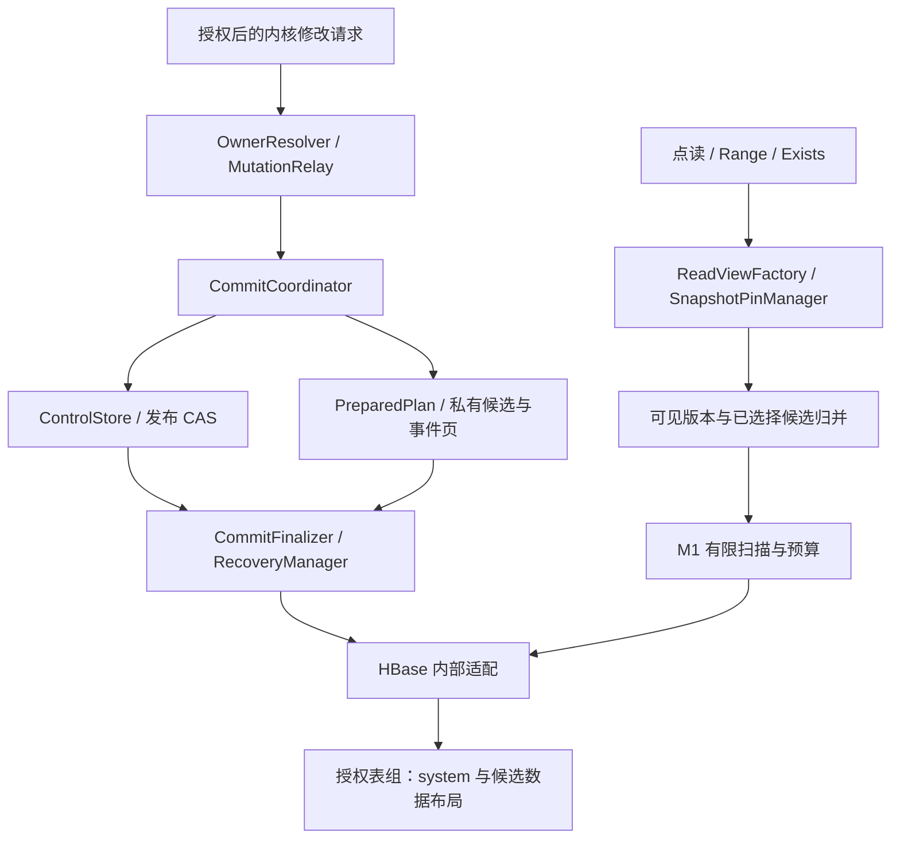

# M2 提交、MVCC、恢复与热点可行性设计

**状态：待设计评审** · **日期：2026-11-03** · **需求与代码基线：** [DEVELOPMENT_PLAN.md v0.10 / 783b0e9](https://github.com/Reidddddd/etcd-hbase/blob/783b0e961f33f79ccd593262b8a30a5f93520bfe/DEVELOPMENT_PLAN.md)

> 本文定义 J20–J29 的提交、可见性、跨副本读保护与恢复契约，沿用已批准的 [M0 设计](2026-10-10-m0-engineering-environment-protocol-design.md)和 [M1 设计](2026-10-30-m1-storage-scan-budget-design.md)。具体执行步骤、验证命令与恢复记录由实施计划维护。本 PR 仅提交设计，设计获批不代表实现、负载或阶段验收通过。

标记约定：**事实**来自上述固定基线；**已确认要求**沿用主计划；**提议**需本轮评审与后续原型证明；**待输入**不能由公开临时环境结果代填。除明确列为事实者外，本文的组件、字段与算法均为待实现设计。

## 1. 目标、现状与范围

M1 解决原始字节、物理版本读写、有限盐桶扫描与资源预算。M2 要解决的是：多个 key 的修改何时作为一个事务可见，发布响应丢失后怎样判定结果，旧执行器恢复后为何不能覆盖新状态，以及跨副本 Range 如何在同一 revision 上完成。

**事实：** 设计基线已包含 J10–J17 的公开实现。`RecordStore` 明确只提供物理访问，不提供事务或并发快照；CURRENT/HISTORY/NATIVE 原型的 `m`、`v` 列尚无提交归属和落地 fence。既有原型不能直接装入生产业务 handler。J18/J19 不在该固定基线中，实施前须核对相应已审查交付及实际装配，不能把未整合的分支当作前置已满足。

**已确认要求：** 每表组一个活跃提交器，最多一个已发布但未收尾的提交；HBase 是业务权威状态，不依赖服务本地磁盘。通用 SPI 保持 JDK-only，提交、可见性和 fencing 不成为扩展可绕过的接口。

| 任务 | 本阶段设计契约 |
|---|---|
| J20 | 控制状态、commitSequence / visibleRevision / txnId、格式与不变量 |
| J21.1 / J21.2 | HBase 权威 owner epoch；修改请求发现、授权转发与结果未知边界 |
| J22 | txnId 隔离的私有准备、完整事件与有界分页计划 |
| J23 | 唯一发布 CAS；从持久化证据解析成功、未选择及未知结果 |
| J24.1 / J24.2 | 两种历史布局对照选型；决定归档、幂等落地与持久化检查点 |
| J25 | 一致读屏障、已选择候选叠加、历史 key 枚举与固定 ReadView |
| J26 | 跨副本持久化 pin、过期 fencing 和 GC 边界接口 |
| J27 | 各崩溃窗口恢复；发布后的服务上下文与身份生命周期 |
| J28.1 | 内核最小 Compare/Put/Delete/Read 模型与并发历史 |
| J29.1–J29.3 | 提交、读屏障、模拟续租的成本和单活排队报告 |

J52.1 的版本保留/compaction 原型按依赖提前支撑 J24/J26。J28.2 的真实 Go RPC 并发历史归 M3；J29.4 的真实 Lease 混合负载归 M4。完整 Txn 参数、DeletePlanner、Watch、Auth 会话、Compact RPC、长期 GC、K8s 发布与生产容量继续按所属阶段交付。M2 内核测试驱动不开放伪成功业务 RPC，未实现 handler 继续返回 `UNIMPLEMENTED`。

## 2. 架构与权威状态〔提议〕

| 所属模块 | 职责与状态 owner |
|---|---|
| core | 提交状态机、逻辑记录、ReadView、pin/恢复编排和内部存储 port；不依赖 HBase 或生成 proto |
| hbase | 单行 CheckAndMutate、不可变准备记录、带 fence 落地、物理版本与有界页；实现 core 契约 |
| grpc | 沿用上游 etcd schema 与错误工厂；后续业务适配消费内核真实结果，不自行判定提交成功 |
| server | 表组生命周期、受控 peer 通道、授权上下文、共享预算和服务恢复执行器 |
| admin / testkit | 专用新格式初始化与诊断；模型、故障驱动、真实后端及同口径负载验证 |

HBase 控制行是 owner 与发布决定的唯一权威。内存队列和缓存的 owner 地址仅用于调度，不授予发布权。恢复进度是可重放的提示，不能覆盖决定。请求持有等待与读结果；服务持有已发送发布及已发布提交的解析、落地和恢复责任。连接仍由既有工厂持有，不能因单个请求结束而关闭共享连接。

## 3. 标识、控制状态与不变量〔提议〕

### 3.1 三种序号的含义

| 标识 | 含义与变化规则 |
|---|---|
| `txnId` | 固定宽度唯一事务标识；每次新的准备尝试独立，不从 revision 推导，不复用失败尝试的私有命名空间 |
| `commitSequence` | 排序已选择的 KV 与系统元数据提交；仅发布 CAS 成功时加一，准备失败不消耗已提交序号 |
| `visibleRevision` | etcd KV 逻辑版本；一次有 KV 修改的提交加一，同次多 key 使用同一 revision；元数据提交不增加 |
| `ownerEpoch` / `stateVersion` | 前者隔离提交 owner，后者防止控制状态 ABA；claim、heartbeat、发布、收尾均推进相应控制版本，不冒充 KV 修改 |
| `invocationId` | 内部调用/转发的同一次尝试标识；绑定请求摘要、授权边界和 txnId，不是 etcd 的客户端幂等键 |

相同 value 的 Put 仍属于 KV 修改；删除空集合或纯读操作没有 KV 修改。没有任何逻辑修改的操作不发布空事务；metadata-only 提交增加 sequence、保持 revision 和 KV 事件不变。Compare 与完整 Then/Else 语义在 M3 补齐；M2 最小模型只能验证其声明的子集。

所有序号使用检查溢出的正向计数，耗尽时停止修改，禁止回绕。新空表组的初始 revision 与 bootstrap 标识须通过固定原生 etcd 对照冻结并持久化；未知/非空表组不能靠构造默认值完成初始化。

### 3.2 控制行与发布槽

控制行的一个有界 `state` 消息原子保存：格式/profile 指纹、owner 实例与 epoch、stateVersion、已发布 sequence/revision、已收尾 sequence/revision、可选发布槽、逻辑 compact 边界。发布槽只含 txnId、invocationId、基准状态、选择后的 sequence/revision 和封存 manifest 根；大列表不进入控制行。

记已发布 sequence 为 S、已收尾为 F，必须始终满足 `0 <= S - F <= 1`。无发布槽时 S=F；有槽时 S=F+1。控制行、决定和数据的读取均使用强一致 HBase 访问，不采用 timeline replica 读。CAS 比较实际读出的完整状态字节/版本，不能用“先 Get，再无条件 Put”替代。

必须保持以下不变量：

1. **唯一选择：** 每个 sequence 只选择一个 txnId 和不可变根；未被选择的候选永不可见。候选存在、timestamp 合法或准备完成均不证明提交。
2. **发布有充分准备：** 只有候选、manifest、完整事件和必要辅助计划全部持久化并封存，才允许发布。未知准备结果先核实，不把超时当成功。
3. **发布不回滚：** 选择后只有归档与完成，不转成 ABORTED；切换 owner 保留发布槽。
4. **收尾先于下次发布与成功响应：** 已选择历史、当前值及必需辅助状态全部可恢复落地后才推进 F、清槽和回复成功；此时决定与结果依据已归档。
5. **旧执行器受限：** 旧 epoch 不能选择新提交；迟到落地也不能回退行状态或复活安全回收的数据。
6. **统一视图：** 同一 ReadView 的所有桶、后取 value、重开 scanner 和 More 判定使用同一版本/保护依据；不存在半个事务的成功结果。

### 3.3 事务状态与调用状态

| 阶段 | 权威依据与合法后继 |
|---|---|
| PREPARING | 私有尝试与部分页；可封存，或在排除选择可能性后结束为 NOT_SELECTED |
| SEALED | 不可变根与完整目录；可被控制 CAS 选择，也可在失去发布资格且确认未选择后结束 |
| SELECTED | 控制槽或其已归档决定；只能归档、落地和完成，不能回滚 |
| FINALIZED | 全部必需落地已确认、决定/结果可查询且 F 已推进；重复恢复保持该结果 |

归档与页检查点记录 SELECTED 到 FINALIZED 的进度，不另建可推翻控制选择的状态来源。UNKNOWN、取消和 deadline 描述调用方的观察，不是已选择事务的提交终态。

例如基准 `(sequence=100, revision=40)` 的两 key 修改选择后为 `(101,41)`，两个 key 的 modRevision 都是 41；随后一次 metadata-only 提交成为 `(102,41)`。准备失败的另一 txnId 即使曾提议 revision 41，也不能写入已选事务的正式版本。

## 4. 持久化格式与准备计划〔提议〕

### 4.1 system 记录与数据格式边界

system 混存控制、调用尝试、manifest/目录页、私有候选、事件页、决定、检查点及 pin 分片，确实需要类别隔离。候选物理格式为 `bucket || kind || EncodeFields(identity)`：kind 使用版本化固定枚举，复合字段采用长度明确或既有有序编码，不拼接歧义字符串。

盐始终置前。控制行、txn/page、决定和 pin 槽的盐输入分别冻结；点定位由其完整路由标识计算，不扫描全部 system 表。KV 私有候选按完整逻辑 key 的盐桶组织，行内标识含 txnId 与 E(key)，使一个 txn 的某桶区间可有界扫描、点读可直达。manifest 页和事件页可分散到不同桶，由封存目录定位。这里的输入规则属于新 system 格式，必须提供向量并写入指纹，不悄悄改动既有 KV profile。

固定控制行即使有盐仍只在一个物理位置，单活也仍串行。候选按 key 分散不能消除控制 CAS 热点或固定热 key；J29 必须分别计量。

| 记录 | 必要内容与约束 |
|---|---|
| 调用尝试 | invocationId、请求摘要、txnId、准备 epoch、基准 sequence、状态及有界结果引用；终态不可被迟到更新覆盖 |
| manifest 根/目录页 | 格式、基准视图、页数/条数/总字节、摘要、桶索引与目录根；目录自身分页，根大小有硬上限 |
| 私有候选 | txnId、key、新元数据/值或逻辑墓碑及内容摘要；元数据/value 分列以支持投影，按 txnId 隔离 |
| 事件/辅助页 | 事务内顺序、PUT/DELETE、KV/PrevKV 与辅助修改计划；未来 Watch 消费完整 revision，M2 不建立 Watch 流 |
| 决定/结果 | sequence、txnId、根摘要、KV revision、调用结果依据；与控制槽核对后不可变归档 |
| 行落地 fence | 已应用 sequence、事务/内容身份及维护代次；与对应数据 mutation 同行原子更新 |
| pin 分片/检查点 | 有界槽及保护下界、代次；恢复阶段和页位置，格式与所属表组明确 |

内部 protobuf 留在 hbase，新增字段验证 presence、范围、身份与摘要，不修改上游 etcd proto。M1 的原始 `m`/`v` 和 CURRENT/NATIVE 普通 Put 没有这些保证；M2 使用显式新 schema/绑定校验。现有未知表或原型表不得被自动接管，迁移/正式 bootstrap 由 J55 负责。

控制、准备、决定和落地均显式使用 SYNC_WAL，descriptor 校验不得放宽。事务/保护记录不使用 HBase TTL 代替应用过期协议。确认写入持久化与文件系统/故障模型分别记录，跨连接读回不充当 WAL 故障恢复证明。

### 4.2 准备与封存

提交器先在稳定基准视图生成有限计划；一次事务每个 key 的最终修改及事件顺序必须确定。候选、目录页和事件页使用 absent CAS 创建：重复相同身份与内容可确认幂等，不同内容报冲突。封存根引用完整的页目录及摘要；封存后不修改根，也不通过追加未列入目录的页扩大计划。

准备中的旧值、PrevKV 和最小 Compare 读取使用受 pin 保护的同一基准视图，停止这些读取后才解除其保护。发布时若基准已变化，原计划不能通过改写 sequence/revision 重新使用；须先确认原尝试未选择，再按新视图重新求值和准备。

计划大小受修改项、key/value 总字节、事件/PrevKV、页数、目录深度、在途页、准备时限和最终响应限制。大范围计划逐页产生、核对和落盘，不把全部 key 或 value 收集进内存；根与单页也有独立字节上限。限制在发布前校验，不能先承诺任意大事务，再因收尾预算不足永久卡住表组。

未发布部分准备失败时，所有读继续看到基准状态。清理未完成准备须先证明该尝试从未被选择且已失去发布资格；epoch 过时本身不能排除它曾经提交。已选择候选还受决定、未完成恢复和 pin 的引用保护；仅凭“年龄较老”不能删除页。陈旧候选清理按持久化范围和限额推进，完整长期回收归 J53。

## 5. owner、请求转发与授权〔提议〕

### 5.1 owner fencing

实例启动生成新的 incarnation，不以 Pod 名称判定同一执行器。接管通过控制行 CAS 增加 ownerEpoch，保留 S/F、槽与决定；已有槽先恢复，不选择新事务。发布 CAS 同时比较 ownerEpoch、基准 sequence/revision、空槽及 stateVersion，任一不符均不能继续。

heartbeat/超时与发现信息只负责接管活性。墙钟偏差可以引起额外接管，不能赋予旧 owner 发布权；即使长暂停的旧进程仍认为自己有效，其 CAS 也应失败。两个副本竞争、接管与正在发送的发布 CAS 必须在真实 HBase 上验证。

全局 epoch 不能隔空 fence 另一行的普通 Put。落地必须使用第 7 节的同行条件写，不允许以“写前读过控制 epoch”为旧写安全证明。

### 5.2 内部修改转发

非 owner 先查询受控 owner 发现信息，再经独立内部通道转发一次内核请求。消息携带 invocationId、请求摘要、预期 epoch、表组绑定、授权上下文安全引用与剩余 deadline；接收方收紧到本地最大预算，不能比较两台机器的单调时钟值。内部消息不扩展上游 etcd 协议。

接收方重新验证 peer、授权表组/身份和请求摘要；地址限定为获批服务发现集合，不根据未经验证的地址发起任意连接。密码和 bearer 凭据不写控制行、manifest、结果或日志。跨副本授权引用的实际激活依赖 B03/B06 与 J50/J51，公开 loopback 测试不等于目标安全通道已验收。

同一 invocationId 先建立持久化尝试映射。发现 owner 改变时重查该映射与决定；可能已发出的请求不换 ID 重放。仅有明确未发送证据才可安全重新派发，转发跳数/重定向次数有上限，不能循环转发。

取消本地等待不撤销可能已到达 owner 的请求；未知结果按第 6 节处理。内部去重只覆盖同一次转发/恢复，外部 etcd 客户端重试没有通用幂等键，不能承诺跨独立 RPC 的 exactly-once。

## 6. 发布、结果未知与成功边界〔提议〕

正常提交顺序为：

1. 准入并固定基准视图，建立尝试映射；预留发布解析和收尾资源。
2. 写入全部私有候选、事件/辅助页、目录，核实结果并封存根。
3. 控制行 CAS 选择该根：S 加一；存在 KV 修改时 visibleRevision 加一；设置发布槽。
4. 依据槽归档不可变决定、落地并记录检查点；全部完成后 CAS 推进 F 和 finalizedRevision，清除槽。
5. 从已持久化结果依据构造成功响应。响应写出失败不重新提交。

**第 3 步是修改的线性化点。** 第 4/5 步尚未完成时，同期读可以看见整个已选择事务，但修改方尚不能收到成功。owner 切换或客户端取消不能撤销该决定。

| 发布观察 | 对内核调用方的含义与处理 |
|---|---|
| 尚未发送且被取消/拒绝 | 明确未发布；释放请求工作并按规则清理准备 |
| CAS 确认成功 | 已选择，移交服务恢复上下文；落地前不回复成功 |
| CAS 条件不匹配 | 不直接推断本次从未选择；查询同一 txnId 的槽、决定和尝试映射 |
| CAS 超时/断连/调用方取消 | 结果未知；继续查询原尝试，禁止分配新事务盲目再次发布 |
| 持久化证据确认未选择且旧发布资格已 fence | 才能返回确定未提交；必要时由上层显式发起新的尝试 |
| 结果保留期已过或 HBase 仍不可用 | 保留“无法判定/已过查询窗口”，不将缺记录解释为未提交 |

查询先检查控制槽，再核对对应 sequence 的决定归档与调用映射。归档先于清槽/下次发布，因此前进后的控制状态不能让选择依据消失。不同 txnId 占据同一提议 sequence、部分归档或结果记录损坏均须有明确分支；不能只读 `lastTxnId`，也不能以当前 revision 大于提议 revision 推断成功。

请求错误类别与提交确定性分别保存。HBase 权限、不可用、超时、取消、资源不足和损坏不能变成空 KV 或 Compare=false。后续 gRPC 映射复用既有工厂及 API 矩阵，不引入自定义的伪成功 etcd 响应。

## 7. 已选择版本落地与历史布局〔提议〕

### 7.1 共同落地规则

只有从控制槽/决定核实出的选定事务可以写公共版本。未选择的准备永远留在 txnId 私有空间，不能提前写共享 `m`/`v`，因此失败事务复用同一“提议 revision”也不会污染成功版本。

所有落地内容和 timestamp 确定，归档/落地重复不分配 revision。同行 `CheckAndMutate` 同时修改 fence 与元数据/value；普通历史版本读不把 fence 当业务 Cell。当前值按 sequence 单调更新：相同已应用事务核对摘要后 no-op，更高 sequence 证明旧收尾已被覆盖时不得回写；冲突内容报错，不能吞成幂等。

跨表 batch 仅是传输优化。每项结果与真实 producer 完成分别记账；任一必需项尚未知，不能推进全局 F。原生 Delete 不表示业务删除，逻辑墓碑必须参与可见版本与事件构造。

### 7.2 两种候选与保留约束

| 维度 | 独立 HISTORY + CURRENT | NATIVE Cell 多版本 |
|---|---|---|
| 正式版本 | `bucket || E(key) || BE64(revision)` 不可变历史；先历史后当前 | `bucket || E(key)`；同一逻辑版本 m/v 的 timestamp 均为 `revision - 1` |
| 私有准备 | system 中按 txnId 隔离，发布后才进入正式历史 | 同样隔离；禁止把普通共享 qualifier 的未选择 Cell 当候选 |
| 幂等/迟到写 | 历史行创建及内容核对；当前行 fence CAS，不能覆盖更高 sequence | 数据与最新 fence 同行 CAS；旧 CAS 在较新落地或维护 fence 后失败 |
| 历史读 | 同 key 寻找最大 revision 不超过视图者；墓碑/枚举入口受保护 | 同 key 选择对应 timestamp 的 m，再读取精确匹配 v；不能回退到较旧 value |
| 回收风险 | 删除历史行后，迟到 absent CAS 可能重新插入；需退休 guard 或已证明的写者排空 | TTL/版本上限/compaction 可能自动丢失受保护版本；维护与旧写须共用行 fence |
| 比较成本 | 真实历史/当前写、索引、guard、恢复和读回成本 | 私有准备、条件写、版本检查、保留准入、历史扫描与恢复成本 |

Native 的 timestamp 上界沿用 M1：读取 revision r 对应 `[0,r)`，避免 `Long.MAX_VALUE` 时间哨兵。timestamp 只负责定位，提交归属仍由选择/落地规则证明。

M1 原型 `maxVersions=64` 不代表保留任意历史。Native 候选必须禁止 TTL 自动过期，并在发布前证明新增版本不会突破配置版本数、驱逐 Compact/pin 仍需要的版本。可采用受控版本上限与有界版本检查/计数，空间不足时先安全回收或明确拒绝，不能任由第 65 次写入静默丢掉第 1 个受保护版本。计数/保留检查自身须覆盖并发恢复、逻辑墓碑和重复落地；不能靠无限放大版本数消除问题。

回收也是写者：Native 的版本删除与维护 fence 在同一行原子更新；HISTORY 行创建比较 guard 缺失，而非只比较 `m` 缺失。被清理行保留不可被旧 absent CAS 越过的退休 guard，直到证明相应在途写与旧执行器不能再重放。M2 不默认物理删除这些 guard；其空间增长、排空证明与后续安全回收约束进入 J52.1/J24 报告。不能把 HBase 删除标记或一次 epoch 检查当作永久阻止迟到重插的保证。

J24.1 比较相同变更序列、盐/分区、WAL、保留窗口、pin、发布/收尾、故障和 compaction 后结果。任何候选如果不能满足隔离、保留或恢复约束，先排除；正确性通过后再比较操作数、字节、空间、p99 与接管成本。最终选择由 J24/J25 共同冻结；本设计不预先指定生产布局。

## 8. 一致读、历史枚举与 ReadView〔提议〕

### 8.1 建立视图

默认读强一致获取一次控制状态作为读屏障，捕获 S/F、published/finalized revision、选定槽与 compact 边界。当前读取该屏障的 visibleRevision；指定历史 revision 先核对未来/压缩边界。Serializable 请求首版仍可走同样的更强一致路径，不启用未经证明的新鲜度缓存。

`ReadView` 是不可变内部对象：表组/profile/授权范围、屏障 sequence、目标 revision、稳定基线 revision、可选选定根、压缩边界与持久化 pin 代次。随后注册第 9 节的 pin、复核注册期间的边界与必要根；失败则在开始数据 I/O 前重试建视图或明确失败。所有后续访问绑定同一对象，不因重试或换桶刷新成“最新”。

读的线性化位置是取得有效控制屏障的强一致读取；已完成修改的读后请求不能使用早于该修改的缓存水位。跨行 Scan 本身不提供快照，必须按下述不可变版本与保护规则重建。[HBase 扫描一致性](https://hbase.apache.org/acid-semantics/#consistency-of-scans)、[etcd API 保证](https://etcd.io/docs/v3.5/learning/api_guarantees/)

### 8.2 已发布未收尾时的完整可见性

稳定基线只读取不超过 `min(目标 revision, finalizedRevision)` 的已落地版本。若捕获的槽有 KV 修改且其 revision 不超过目标值，则按 key 将该槽的私有候选叠加到基线：新增进入结果，更新替换旧版本，墓碑遮蔽旧值；metadata-only 提交不产生 KV 叠加。

候选由封存的桶索引有界读取，不为每个 key 扫描整份 manifest，也不整体加载事务。枚举与点读均核对封存目录中的身份/摘要，物理前缀扫描不能把目录外的迟到行纳入视图。基线即使在扫描期间继续收尾，也以固定 revision 上界过滤；下一次提交产生的版本不能进入本视图。捕获的选定根即使已清槽，也由 pin 保护到读结束。

叠加必须在全局 key 排序、过滤、Limit/More 和存在性判断之前发生。特别是尚未落地的新 key 必须参与归并，已删除 key 不能让 Exists 提前返回 1。More=false 仍需同一视图下的耗尽证明；不足以判断时返回错误。

### 8.3 历史 key 与分页

已删除 key 的旧版本仍可能满足历史读取。HISTORY 以历史 key 流为完整枚举依据，或使用已证明覆盖该历史窗口的持久入口；不能只枚举当前活 key。NATIVE 必须保留历史版本及必要墓碑。最新值已变成更高 revision 时，CURRENT 不能作为旧视图的唯一来源。

沿用 M1 的有限物理页、原始字节排序、全局 L+1 与轻量 Count。断点绑定视图，记录最后完整消费的逻辑 key；Region move/split、页重开或部分消费不能跳过版本组。head 只取元数据，后取 value 必须定位同一选定版本及事务身份；缺失、错版或保留破坏使整次读失败。

元数据选择产生内部 `SelectedVersionRef`，明确来源是已落地版本还是某个选定 txnId 的私有候选，绑定 key、revision、根/内容身份和投影。后取 value 按此引用访问对应来源，不把候选 head 再交给“读最新值”的物理 Get。该类型由 core 内部查询链消费，不进入公共 SPI。

小 scanner 配额仍须前进。视图叠加增加的 candidate 页、版本过滤和查找单独进入既有预算，不直接复用 M1 冻结数据的“全部可见”假设。无 Limit 的 unary 响应在总字节不足时整体失败，不返回半份快照。

## 9. 跨副本 pin、过期与 GC 边界〔提议〕

### 9.1 有界持久化 pin 注册表

每表组预先定义有限个 pin 分片，每个分片行保存有限槽、单调代次及允许注册的 revision/决定保护下界。槽绑定随机 pinId、ReadView、所需根引用和代次；保护 revision 取该视图实际需要的稳定基线，不能只取目标 revision。例如目标 41 叠加选定候选时，仍须保护基线 40 和候选根。槽数与行序列化字节均有限，不能随全部 KV 或失联请求无限增长；分片数属于格式配置，不在线静默调整。

注册、续期、完成和撤销都 CAS 同一分片行。注册只允许不低于该行已推进保护下界的视图。GC 在分片行 CAS 内依据仍有效的槽计算可推进下界，先持久化阻止更旧注册，再综合全部分片的最小值决定可回收范围；缺失/未知分片不视为空。这样，注册和下界推进具有真实的同行竞争点，不依赖“先扫 pins，再删历史”。

pin 注册后再次核对控制边界及必要根，完成前不进行数据读取。已存在的 pin 可以保护 Compact 之前开始的读；新读是否接受旧 revision 仍由逻辑 compact 边界判断。注册结果未知先查询原 pinId/代次，不能制造未受保护的成功 ReadView。

### 9.2 过期不是无条件回收许可

期限用于触发撤销，GC 必须 CAS 将具体代次从 ACTIVE 改成 REVOKED 后，才不再计入保护。读者长暂停、续期结果未知或本地认为有效都不能恢复被撤销的代次。时钟偏差最多导致请求提早失败；不允许因时钟假设而返回损坏快照。

读者在数据访问前检查 scope/保护，完成全部 I/O 并持有最终有界结果后，再以同一槽的有效代次完成最终验证/结束 CAS。若撤销先赢，丢弃结果并返回视图失效或超时；若完成先赢，后续不再访问历史，即可解除保护并交付已持有结果。返回 future 结束不替代这一步，不能边释放 pin 边继续后取 value。

最终验证前不向业务调用方交付部分 KV；解除 pin 后的结果必须完整持有原始字节，不能隐藏后续懒加载。后续 Watch 流的分 revision 交付与保护另外设计，不能照搬 unary 结束规则。

取消先停止新 I/O，再等待实际 scanner/producer 清理，最后释放 pin；释放失败由有限收尾/过期撤销接管。请求结果、清理完成和预算 drain 分别观察，沿用 `Account.termination()` 与 RequestScope 的所有权约定。

### 9.3 给 GC 的最小契约

逻辑 compact 边界、物理保留下界、决定/结果查询窗口分别记录。物理清理下界不高于逻辑 Compact 许可、所有有效 pin 的稳定基线，以及发布槽/未完成恢复仍需的基线；根、决定与结果另受相应引用和查询窗口约束。推进过程与逐页清理有持久化检查点，重复运行幂等。

即使安全下界为 H，也不能删除全部 `revision <= H`：每个 key 必须保留重建 H 及更高视图所需的最后一个基线版本/墓碑，并保留更高版本。事件页、决定、候选及历史枚举入口分别计算依赖，不能套同一 TTL。迟到写隔离仍按第 7 节执行。

M2 交付边界计算、pin/推进竞争与专用临时环境中的受控清理原型；完整 Compact RPC、Watch 引用、长期物理回收和 guard 回收由 J52/J53 补齐。没有这些证据前保持相关清理关闭，不能凭原生 compaction 已完成宣布逻辑 GC 安全。

## 10. 恢复、取消与服务生命周期〔提议〕

RecoveryManager 启动先验证格式/profile、授权身份和控制状态；取得新 epoch 后定位唯一发布槽/检查点，不扫描全部 KV 寻找未完成事务。已选事务验证封存页、补归档、逐页落地、核对持久化进度并推进 F。检查点落后只导致有界重做，不能用“页号已推进”掩盖数据尚未确认。

| 崩溃/失败窗口 | 恢复义务 |
|---|---|
| 尝试映射或部分私有页已写，尚未封存/发布 | 不可见；fence 旧发布资格后按限额回收 |
| 根已封存，发布尚未发送 | 查询原尝试；fence 发布资格并确认未选择才结束为未提交 |
| 发布 CAS 可能执行但回复丢失 | 查槽/决定；保留未知，不重新分配 revision |
| 槽已选择，决定尚未归档 | 从槽补归档，再继续同一事务 |
| 历史、当前值或辅助状态只完成部分 | 用固定内容/fence 重做；读视图仍见完整已选择事务 |
| 全部落地，F 尚未推进 | 核对证据后推进同一 F，不生成新提交 |
| F 已推进，调用结果未送达 | 从保留的决定/结果查询；不再次修改 KV |
| 旧 owner 在上述任意阶段恢复 | 私有旧页不进入新事务；发布 epoch 与行落地 fence 均生效 |

发送发布前预留有界的服务解析/恢复容量。发送后即使请求 deadline 已到，也由服务上下文解析可能的选择；已发布事务不借用已关闭请求的 scope/预算继续工作。后台重试有退避、每轮上限和持久化进度，后端持续故障时保留 PENDING、降低表组就绪并阻止下一次发布，不丢弃决定或创建无限任务。

后台身份必须能继续执行该已授权提交。manifest 只保存安全引用与授权范围，不保存密码/token；token 过期不撤销持久化决定。缺少可用恢复身份时明确数据未就绪，认证激活入口保持可达；跨副本/全部 Pod 重建能力等待 B03/B06 与后续身份任务证明。

关闭顺序为停止新提交/转发与新视图，结束请求及 pin，保留或持久化服务恢复进度，等待真实在途操作按截止时间 drain，再关闭连接和身份上下文。超时明确报告未清理项；另一个副本按持久化槽接管，不能把进程退出包装成事务回滚。

## 11. 预算、调度与热点报告〔提议〕

复用 M1 单一全局/表组/请求预算账本，增加准备页、事件/PrevKV、pin 槽、发布解析和恢复 lane 的实际资源；不要为每个表组再创建一份名为 global 的独立限额。普通请求不能耗尽恢复、取消和清理必需容量。

单活队列有条数、字节、排队时间与事务大小上限。J29 分别比较短 KV、大事务、metadata-only 模拟续租的有限公平调度；优先级不能使普通写或到期工作无限饥饿。模拟续租只验证元数据提交与排队，不声称完成 Lease TTL/到期竞争。

| 报告 | 必须分开记录 |
|---|---|
| J29.1 提交 | 入队/准备/发布/归档/落地耗时，control CAS 尝试/冲突/未知，业务与内部操作/字节、大小事务互相阻塞 |
| J29.2 读取 | 读屏障、pin 注册/续期/结束、候选叠加、跨桶页重开、选定 value 后取、恢复期间读延迟与放大 |
| J29.3 模拟续租 | 元数据提交率、与 KV 混合的队列等待、p50/p95/p99、饥饿与切换成本；真实 Lease 缺口单列 |
| 资源/故障 | heap/direct、在途字节、scanner/线程、服务恢复容量、pin 占用、远端关闭与接管时延；账本峰值不冒充 JVM 峰值 |

使用冻结的请求分布、seed、变更序列/摘要、并发、事务大小、桶/分区、保留窗口、client/JDK 组合及硬件/profile。两种布局计入完整协议成本，不省略 system、当前值、guard 或 pin。应用操作、实际 RPC/重试、返回 Cell 字节、服务端扫描与可获得的 WAL/HFile IO 分别报告，不可观测项保留缺口。

在后端容量充足的前提下测兼容层串行点。加 Pod、加盐或把控制表拆名都不能作为提高单表组提交并行度的证据。B04/B05 未冻结时可提交公开合成负载的趋势与失败边界，不宣布 p99、容量或恢复目标达标；报告不支持该内核时必须调整方案，不能只调高资源上限通过。

## 12. 验证设计与证据门槛

下表是实施验收要求，本设计 PR 不将其记为已执行。最小模型、真实 HBase、进程故障、原生协议和目标环境各有独立证据。

| 验证面 | 必须命中的场景与判断 |
|---|---|
| J20 状态模型 | 元数据不增长 KV revision；多 key 统一版本；计数极值/ABA；格式/损坏拒绝；S/F/槽不变量 |
| J21 owner/转发 | 两副本竞争、接管与发布并发、旧进程长暂停后返回；重复转发、摘要不符、授权失效、发送前/后取消和跳数限制 |
| J22/J23 准备/发布 | 每页准备失败、未封存根、缺页/错摘要；CAS 成功丢响应、失败与未知查询；决定前后切换、查询窗口过期 |
| J24 落地/布局 | 两布局回放同序列，删除重建/相同提议 revision 的不同 txn；旧 finalizer 迟到与更新/回收竞争，冲突内容不当作幂等 |
| J25 视图 | 发布前/后、部分收尾、多次后续写之间跨桶扫描；未落地新 key、墓碑、旧 revision 枚举、值错版、More 与 Exists |
| J26 pin/GC | 注册与下界推进、续期与撤销、长暂停、最终交付与撤销的确定性竞争；跨副本 pin、分片未知、候选叠加所需旧基线与锚点保留 |
| J27 恢复 | 第 10 节全部窗口逐一注入；清空应用内存、重启/切换进程，revision 不重复增长；后台身份失败不报成功 |
| J28.1 模型/历史 | 独立串行参考模型校验最小操作历史；保留 invocation/return、发布决定与未知状态，不能把超时操作一律当未执行 |
| J29/J52.1 成本/保留 | 真实准备/发布/收尾与 pin 成本；超过 native 版本阈值、flush、minor/major compaction、迟到写和活跃历史读对照 |

模型检查覆盖有界状态空间和明确故障假设，随机压力补充探索；均不单独证明真实 HBase 的原子性、持久性或网络行为。并发测试用 barrier/受控故障点命中时序，不能只检查最终计数或靠固定 sleep 等待。

真实临时集群必须记录 WAL/文件系统与故障模型。已有 M1 MiniCluster 使用同主机/本地文件系统；它能提供真实 client、CAS、版本、scanner 与 compaction 证据，但不能替代 HDFS/WAL 故障恢复、目标认证和生产多机网络验证。应用进程崩溃恢复与 RegionServer/WAL 故障持久性分别验证；尚未执行的组合明确保留。

J28.1 的最小内核驱动可复用 J07 的无损 trace/错误分类，但不冒充 J28.2 的真实 RPC/Milvus 证据。C1 的 Go→Java 业务检查点仍需相应 M3 handler 与基础认证子交付；M2 模型通过不自动完成 C1/C2。

## 13. 决策、输入与阶段退出

| 待确认设计选择 | 提议与否决条件 |
|---|---|
| 提交排序 | 单活、唯一控制 CAS、一个已发布未收尾槽；J29 不支持目标时重审并行/调度，不假定水平扩容解决 |
| 准备与发布 | 私有不可变根/页，完整准备后选择；不能隔离同提议 revision 的候选则否决 |
| 历史布局 | 保留两候选至 J24/J25/J52.1；隔离、保留、恢复失败者不能因表少或单次快而胜出 |
| 读保护 | 固定分片有界 pin，同行注册/推进/撤销；只用本地 pin 或非原子扫 pin 的方案不接受 |
| 回收与旧写 | 行 fence、退休 guard 或等价已验证隔离；guard 空间和回收证明不成立时保留风险/调整布局 |
| 取消与成功 | 已发送发布由服务解析，已选只完成不回滚；成功在全部收尾后，未知不重放 |

| 输入 | 对本阶段的影响 |
|---|---|
| B01 | 目标盐输入、编码/桶/分区与向量；公开 system/KV profile 可先原型，目标格式不代填 |
| B02 | 实际 HBase/client/Hadoop/JDK 组合及故障入口；不强迫目标升级到公开原型版本 |
| B03/B06 | peer/后台/跨副本身份、TLS、凭据安全引用与轮换/激活；未取得时不能承诺目标恢复和授权转发 |
| B04/B05 | 提交/读屏障/续租、数据/版本/事务大小、p99/资源/恢复目标；未冻结时不作容量或内核最终负载判定 |
| I07/I08 | 许可证、制品与发布授权；设计与本地原型不隐式确认发布决定 |

M2 退出要求 J20–J27、J28.1、J29.1–J29.3 及支撑选型的 J52.1 证据齐备：提交不变量、两种候选的取舍依据、选定布局的一致读、跨副本 pin、全部声明的崩溃窗口与旧 owner 隔离通过，负载报告支持内核冻结。目标输入/故障证据缺失时区分公开子交付与最终冻结条件，不关闭相关风险或宣布阶段通过。

J28.2 与 J29.4 继续归 M3/M4，主任务保留跨阶段未完成项，避免形成 M2 等待完整 M3/M4 的循环。作者自审、独立复核、维护者正式 review、公开临时环境与真实目标验收分别记录；本 PR 不修改任务勾选或阶段完成数。

## 14. 依据与阅读方式

- [主计划与 J20–J29](https://github.com/Reidddddd/etcd-hbase/blob/783b0e961f33f79ccd593262b8a30a5f93520bfe/DEVELOPMENT_PLAN.md)、[M0 设计评审 PR #2](https://github.com/Reidddddd/etcd-hbase/pull/2)、[M1 设计评审 PR #14](https://github.com/Reidddddd/etcd-hbase/pull/14)。
- [M1 存储格式与物理 port 边界](../storage-format.md)、[M1 公开基准及口径](../benchmarks/m1-public-baseline.md)、[API/错误矩阵](../api-matrix.md)、[请求生命周期](../config/j06-runtime-configuration.md)。
- [HBase ACID/扫描语义](https://hbase.apache.org/acid-semantics/)、[AsyncTable](https://hbase.apache.org/2.6/devapidocs/org/apache/hadoop/hbase/client/AsyncTable.html)、[固定 2.6.6 CheckAndMutate](https://github.com/apache/hbase/blob/rel/2.6.6/hbase-client/src/main/java/org/apache/hadoop/hbase/client/CheckAndMutate.java)、[版本与保留](https://hbase.apache.org/book.html#versions)。
- [etcd v3.5 API 保证](https://etcd.io/docs/v3.5/learning/api_guarantees/)、[固定 v3.5.23 wire schema](https://github.com/etcd-io/etcd/blob/v3.5.23/api/etcdserverpb/rpc.proto)。

官方资料约束底层原子性、扫描与版本行为；本文应用提交协议是本项目的提议，不是 HBase 或原生 etcd 已提供的实现。实施时核对锁定 client 源码及实际目标组合，不能从单个版本的验证外推全部环境。
