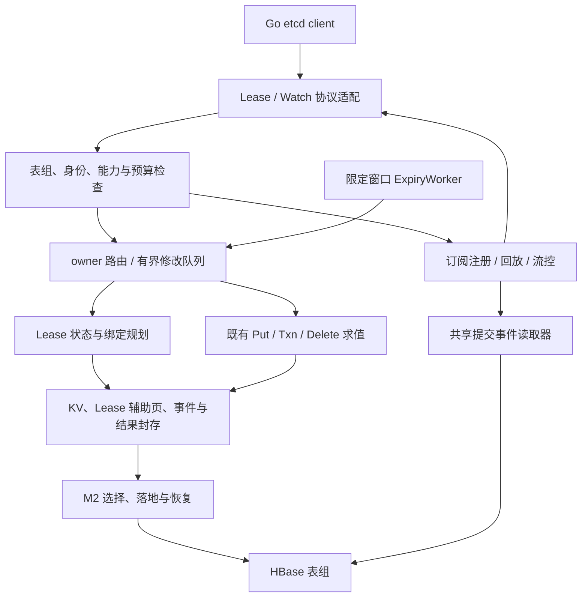

# M4 Lease、注册监听与 Watch 设计

**状态：待设计评审** · **日期：2026-11-11** · **需求与代码基线：** [上游 main / d4e740a](https://github.com/Reidddddd/etcd-hbase/tree/d4e740a89a0b55d5004639007fe1ce59a1521115)

> 本文定义 J40–J47 的行为、持久化、原子性、恢复和验证契约，承接 [M0](2026-10-10-m0-engineering-environment-protocol-design.md)、[M1](2026-10-30-m1-storage-scan-budget-design.md)、[M2](2026-11-03-m2-commit-mvcc-recovery-design.md)、[M3](2026-11-06-m3-kv-txn-compatibility-design.md)、[主计划](../../DEVELOPMENT_PLAN.md) 与 [API 矩阵](../api-matrix.md)。本文是供评审的设计规格；实施步骤、机器配置、执行恢复记录及原始报告留在本地。

**事实**来自上述代码基线或固定上游；**已确认要求**来自已批准计划；下文新增组件、格式与算法均为**提议**，设计获批不表示功能已经实现或阶段验收已经通过。目标环境与性能输入单独记录，不阻塞可独立完成的开发和 MiniCluster 功能验证。

## 1. 要解决的问题与当前基础

M3 提供无 Lease 的 KV、Range、Txn 与删除路径。M4 要使客户端能够创建租约、将一组注册 key 原子绑定到租约、持续续约，并在撤销或到期时原子删除仍属于该租约的 key；同时通过 Watch 把已提交的变更按 revision 和事务内顺序交付给订阅者。

例如，注册方 Grant 得到租约 L，在一个 Txn 中注册主体及多个角色 key，并写入不带 Lease 的 version key。发现方先取得列表及 revision R，再 Watch R+1；注册方续约不产生 PUT，失联后到期删除只移除仍绑定 L 的角色 key，DELETE 携带所需 PrevKV，独立 version key 保留。[调用基线 U05–U08](../milvus-etcd-usage.md)

**事实：** 基线已包含 J30–J35、J28.2 真实 Go RPC 历史和默认关闭的 J36 缓存原型；`LeaseService`、`WatchService` 仍返回 `UNIMPLEMENTED`。`ManifestRoot` 已绑定候选、事件目录和结果引用，`EventPage` / `PreparedEvent` 已保存事件与前值；现有 finalizer 仍只落地 KV 候选，没有 Lease 辅助状态目录和落地流程。现有 `M3TableGroupRuntime.open` 要求启动实例取得 owner，不能据 J21 的内部转发模型宣称两个完整运行时已可同时服务。

M4 不重建提交内核，不把 HBase TTL 当作租约，也不以扫描 latest 推测 Watch 事件。KV、Lease 变化与事件都以 M2 的控制行选择为权威。

**表 1 M4 任务与设计交付**

| 任务 | 本设计规定的交付 |
|---|---|
| J40 | Lease 权威状态、Grant、TimeToLive、LeaseLeases、ID 碰撞与恢复；最小辅助提交和运行时装配 |
| J41 | Put/Txn 的绑定、换绑、解除、绑定预算与多角色注册原子性 |
| J42 | KeepAlive 双向流、持久化后响应、失败与接管顺序 |
| J43 | 限定时间窗口的到期处理、Revoke、统一删除与恢复 |
| J44 | 已提交事件定位、共享 EventTailer、保留保护及读取预算 |
| J45 | Watch create/cancel、多个 watchId、字节范围订阅索引 |
| J46 | 历史回放到实时交接、progress、fragment 与断流恢复 |
| J47 | gRPC readiness、慢消费、取消、compaction 与资源排空 |

J29.4 的真实 Lease 混合负载报告随 J40–J43 补齐。正式 Compact、长期 GC、完整 Auth 生命周期、运维与真实 Milvus 部署继续归相应 M5/M6 任务；M4 必须提供它们所需的事件保留、身份与回收接口及真实失败行为。J36 保持关闭，不能将身份或缓存的未完成项计为本阶段已解决。

## 2. 架构、职责与不变量〔提议〕

**图 1 Lease 与 Watch 架构**

**表 2 模块职责与所有权**

| 模块 | 职责与所有权 |
|---|---|
| core | Lease、binding 与 expiry 模型，辅助计划、可见视图、撤销规划，事件游标、订阅状态与预算；只依赖既有 core/SPI 边界 |
| hbase | 新系统记录编码、不可变页、条件落地、限定范围扫描和 pin 持久化；所有业务修改显式 `SYNC_WAL` |
| grpc | 固定 proto 转换、逐 RPC 错误/Header 投影、入站需求控制、readiness 和串行出站；不持有 HBase 连接 |
| server | 每表组运行时、owner 路由、后台授权上下文、共享 tailer、时钟健康、生命周期和资源账本 |
| testkit | 固定原生 etcd、Go client、确定性竞争、故障历史、MiniCluster 和注册发现证据 |

名称描述职责，不要求逐个新增接口。没有实际装配需求时不扩展公共 SPI；HBase/gRPC 类型及提交模型不进入通用 SPI。

必须始终成立：

1. **唯一发布依据。** 未选择的 Lease 辅助页和事件页永不可见；Lease 元数据与 KV 不产生第二套提交决定。
2. **续约承诺可恢复。** KeepAlive 成功前，权威状态和新的到期定位均已持久化；丢失内存或 owner 切换不能退回旧 deadline。
3. **绑定与 KV 同时生效。** key 的 Lease 元数据、正反绑定依据、预算计数与 KV 候选由同一次发布选择。换绑、解除、删除和重建均按当前工作视图计算。
4. **撤销原子。** Lease 失效、仍有效的绑定删除、PrevKV 和 DELETE 事件由同一次发布选择；不能逐页提交部分删除。
5. **无伪事件。** Grant、纯续约与辅助维护只推进内部 sequence，不增长 KV revision、不产生 KV 事件；有 KV 删除的 Revoke/到期只增长一次 revision。
6. **流不越过未消费历史。** Watch 对一个订阅按 revision 和事务内 ordinal 有序交付；progress 不能越过尚未交付的匹配事件，缺页或失效保护不能解释为没有事件。
7. **资源有所有者。** 请求取消不终止已选择事务的恢复；出站排队、序列化和在途 HBase producer 都受预算约束，物理排空前不归还容量。

## 3. Lease 数据与辅助提交〔提议〕

### 3.1 内部记录与编码

逻辑记录如下；斜杠只是说明字段，不是将字符串路径直接存成 rowkey。按既有盐 profile、固定类别和无歧义字段编码落在 system；不修改外部 etcd proto 或业务 KV rowkey。

**表 3 Lease 与事件内部记录**

| 记录 | 关键字段与用途 |
|---|---|
| Lease 状态 | `leaseId`、`incarnation`、`grantedTTL`、`deadline`、`renewalGeneration`、`state`、最后选择 sequence、绑定条数/字节/撤销成本计数 |
| Binding 版本 | Lease incarnation、原始 key、该 key 的 create/mod revision 与当前绑定身份；显式存在/解除标记 |
| Expiry 候选 | 时间窗口、Lease ID/incarnation、renewalGeneration、deadline 与选择依据；只用于定位 |
| Lease 枚举入口 | Lease ID 的有序可见状态入口，供 LeaseLeases；不扫描业务 KV |
| 辅助目录与页 | 事务身份、辅助 domain、逻辑 key 范围、条数/字节、摘要、版本与序号，供准备、叠加、落地及恢复 |
| Expiry 检查点 | 每盐桶/窗口的已完成位置、未完成候选引用与 worker fencing 信息 |
| 事件 revision 索引 | KV revision → sequence/txnId/封存事件根摘要；用于历史定位，不自行证明提交 |

Lease ID 保留 wire int64 位模式，Grant 的 ID=0 触发自动分配；显式非零 ID 在固定视图中查重，不能仅因 Java 有符号表示而拒绝负 ID。自动分配按[上游分配入口][lease-server]使用正 int64 候选和权威碰撞检查，重试次数有界，不能用 `abs`、取模或进程本地计数冒充全局唯一。内部 `incarnation` 区分同 ID 的不同生命周期，`renewalGeneration` 区分同生命周期的续约；均检查溢出，不回绕。ID 可被重新 Grant 时，旧 expiry/binding/worker 仍不能作用于新 incarnation。

权威生命周期为 `ACTIVE → REVOKED`，只由已选择提交改变；`EXPIRED_CANDIDATE` 是调度观察，不是先行公开的终态。deadline 越过后不能仅在读取端隐藏 key，Lease 失效与 KV 删除仍须一次选择。KeepAlive 在权威处理时已经确认到期的，先推进/解析同一撤销，不允许以正 TTL 复活；撤销尚未知时保留失败/等待，不能提前伪装 TTL=0。时间边界上的续约与撤销按原生竞争场景验证。

Binding 盐输入使用 Lease ID/incarnation，使同一租约可以直接定位有界范围；expiry 按窗口和冻结路由字段计算各桶范围，避免全部记录集中到同一时间热点。事件 revision 索引按 revision 路由，有序历史 seek 枚举有限桶并归并。编码向量须覆盖负 ID、int64 边界、零字节、`0xff`、最坏转义长 key 与 HBase 行长限制；记录类别 ID 由实现时统一分配，不能复用现有枚举值。

内部页通过版本化 proto 编码，并验证 presence、格式/profile、domain、事务身份、覆盖范围、摘要与大小。Lease 不使用 HBase TTL/maxVersions 自动丢弃权威状态或未排空的旧 incarnation fence。

### 3.2 扩展既有封存根和 finalizer

当前 `ManifestRoot` 尚无辅助目录，本阶段须增加可选的有界辅助根，覆盖 Lease 状态、binding 增删、expiry 新候选及枚举入口；这些是 **J40 起必须实现的提交扩展**，不能只写普通 HBase Put 后返回 Lease 成功。

一次 Lease/KV 操作仍走：固定基准视图 → 私有准备 → 目录完整性核实 → 封存 → M2 控制 CAS 选择 → 决定归档、KV 与辅助落地 → 推进 finalized → 响应。封存根摘要绑定辅助根，`containsKeyChanges` 继续仅由 KV 变化决定；只有辅助变更时合法推进 sequence 并保持 revision。

辅助状态以 **sequence** 定位版本，不能以 KV revision 定位，因为连续续约可有相同 revision。正式辅助版本不可变，最新入口是带 sequence/内容身份 fence 的索引；同一版本重复落地只接受相同内容，迟到落地不能覆盖新入口。必要的 tombstone/退休 fence 遵循 M2 的旧写隔离规则。

辅助读使用与 KV 相同屏障的固定 sequence：读取稳定落地基线，再叠加该屏障捕获的唯一已选择未收尾辅助根；点查、binding 枚举、TimeToLive 和 LeaseLeases 均遵守此规则。目录缺页、无法证明不存在、反向计数不符或摘要冲突均失败，不回退为“无租约”。旧视图需通过对应 pin 保护其辅助版本；不得仅覆盖一个 Lease 最新 Cell，再用它回答旧屏障请求。

finalizer 必须在 KV、辅助状态、必需查询索引及结果都可恢复落地后才能推进 F。恢复使用封存内容和原 deadline，不根据重试时钟延长/缩短租约，不重新选择删除集合；已选择事务不可回滚。只有未选择且已持久 fence 的旧尝试可以重求值。

格式能力写入表组指纹和运行能力门槛。旧格式无辅助根可按版本规则解码；旧进程不能对启用新 Lease 格式的表组继续写入。M4 不承诺未验证的混合版本写入或回退；升级/回退路径与格式拒绝测试必须先于启用。

## 4. Grant、查询与 TTL 时序〔提议〕

### 4.1 操作与错误

所有响应 Header 沿用 M3 的真实表组/实例来源。请求 ID、TTL、重复 ID、非法/过大 TTL、整数溢出和错误优先级按固定 [Lease RPC][lease-rpc]、[lessor][lessor] 与 [rpctypes][errors] 对照，不自行规定“TTL<=0 一律错误”；原生存在最小 TTL 的调整行为，最终 `grantedTTL` 必须真实返回。

**表 4 Lease 操作与成功边界**

| 操作 | 内部处理与成功边界 |
|---|---|
| Grant | 进入 owner 队列；在固定辅助视图检查 ID/collision、分配 incarnation 与容量，选择持久状态和首次 expiry 候选；收尾后返回实际 ID/TTL |
| TimeToLive | 取得强一致屏障和同序号 Lease 状态；返回 grantedTTL 与真实剩余 TTL；`keys=true` 在同视图枚举全部仍有效绑定，超预算整体失败 |
| LeaseLeases | 在固定视图枚举有效 Lease；输出全部结果，响应预算不足明确失败，不能无分页地截断成成功 |
| Revoke 不存在 ID | 返回固定原生可识别的 LeaseNotFound；不制造成功撤销或 KV revision |
| KeepAlive 不存在 ID | 流中按原生返回对应 ID、TTL=0，不把业务不存在统一变成整个流 NotFound |
| TimeToLive 不存在 ID | 按原生返回该 ID、TTL=-1；权限/存储失败不能伪装成该 sentinel |

Grant 的新客户端重试不是协议级 exactly-once：外部 proto 没有 invocationId。内部转发/结果未知必须保持原 invocationId；客户端重新发 Grant 或显式 ID 重试按实际已存在状态处理，不凭相似请求推断去重。

### 4.2 时钟与到期判定

Lease 是持久化的时间承诺，既不同于 owner 的控制租约，也不同于 HTTP/2 keepalive ping。只靠进程 `nanoTime` 无法跨副本恢复；只靠任意副本的墙钟也无法保证时钟快跳时不提前删除。

提议使用可注入的时间上下界 `nowLower <= realTime <= nowUpper`：Grant/续约从权威处理时的 `nowUpper` 计算 `deadline = nowUpper + grantedTTL`；到期只有在 `nowLower >= deadline` 时才可选中。上下界来自被验证的时钟偏差/漂移界限，本地单调时钟用于检测异常和超时，不作为跨进程持久 deadline。检查运算溢出、秒/毫秒换算和原生 TTL 取整边界。

TimeToLive 按同一可靠时间观测计算并保守投影剩余秒数，夹在协议允许的范围；返回的 TTL 不承诺从网络收到响应起再完整存活相同秒数。Grant/续约排队耗时和响应发送延迟单独计量。时钟裕量导致的延后过期作为本服务兼容说明与到期延迟报告的一部分，不宣称与原生逐毫秒相同。

时钟健康失效或跳变超界时停止自动到期与依赖可信 TTL 的成功响应，并报告未就绪；不能删早，也不能不断给每次恢复重置完整 TTL 掩盖问题。显式授权 Revoke 不依赖“已到期”条件。重新健康后从持久窗口补查；失效期间延后回收的可用性影响须记录。到期任务发布前复核健康与权威 generation/deadline，旧 epoch 的 CAS 仍受 M2 fencing 约束。

MiniCluster 使用可控时间源验证上述状态机；目标时钟部署策略与偏差数值留待部署输入。该输入影响生产启用条件，不影响公开实现与边界测试。

## 5. 绑定、换绑与原子撤销〔提议〕

### 5.1 与 Put/Txn 的结合

J41 接通 M3 的 Lease 意图：普通 `lease=0` 解除原绑定，非零 ID 验证有效 Lease 后绑定，`ignore_lease=true` 保留旧绑定。`ignore_value` 与 PrevKV 继续沿用原生语义。必须在 owner 的固定基准和事务内工作视图中处理，不能在独立预检查之后绕开发布。

每次 key 修改同时计算旧 binding 的解除、新 binding 的建立、相关 Lease 计数变化与最终 KV。相同租约重复更新避免重复计数，但更新内容引起的最坏撤销成本仍需重算；删除和删除后重建不得复用旧 key 版本身份。Compare 的 LEASE 目标使用同一视图的元数据。

多角色注册 Txn 将带 Lease 的角色 key 与不带 Lease 的 version key 一起封存。Compare=false 的纯读/空分支不修改 binding；选中分支任何 Lease 非法、预算不足或准备失败时，没有任何注册 key 或索引可见。Then/Else、nested Txn 的基准 Compare 与操作顺序继续遵守 M3，不能只支持全请求同一租约。

### 5.2 撤销容量准入

每个 Lease 在接收绑定前核对：绑定数量、key 字节、PrevKV/value 最坏字节、事件量、辅助页/候选页数、目录深度、撤销响应与峰值驻留内存。将这些计数随绑定原子更新，版本/幂等重放不能重复增加。超过额度在发布前拒绝该次绑定，不能先接受再永久撤销不了。

大小变化、换绑和同 Lease 更新也要重新准入。容量按实现可执行的撤销 profile 计算，与普通 Txn 单请求字节上限分开；分页准备限制内存，不把一个 Lease 拆成多个可见删除事务。恢复和 expiry 有独立保留容量及有界公平调度，业务饱和时仍能完成已接受的撤销。提高配置上限或缩减 reserve 前校验存量 Lease，否则拒绝配置变更。

### 5.3 Revoke/到期的共同执行

基线采用与普通修改相同的 owner 队列，并在有界的撤销准备期间保留该操作的串行所有权；不新增一个先公开失效、随后分批删 key 的状态机。

1. 先收尾既有选择槽，捕获辅助/KV 视图，核对 Lease incarnation、renewalGeneration、状态、deadline；自动到期另检查时钟条件。
2. 分页枚举该 incarnation 的绑定。逐项用当前工作视图复核 key 仍存在，Lease 与绑定版本身份匹配；A→B 换绑、无 Lease 重建和迟到旧索引均不得删除新记录。完整性或计数错误失败，不跳过后伪装完整撤销。
3. 准备仍匹配 key 的墓碑、真实 PrevKV、DELETE 事件、绑定解除和 Lease REVOKED tombstone，并封存完整计划。
4. 一次控制 CAS 选择。删除非空时增长一次 KV revision；空 Lease 撤销只推进 sequence。已选后恢复继续同一决定，全部收尾后 Revoke 才成功。

准备中的旧 owner 失权时不发布；新 owner 先解析旧尝试/选择槽，再重试未选择撤销。KeepAlive 与到期的先后由队列和选择决定：续约先选择则旧 generation 候选失效；撤销先选择则续约返回不存在，不复活租约。不能因一次到期扫描观察或普通 CAS 失败就向客户端宣布撤销已完成。

本基线可能因大 Lease 阻塞同表组修改，须在 J29.4 报告最大占用与续约等待。若预算下无法满足已接受 TTL/负载，须缩小准入或另评审调度改进，不能取消原子性。独立 Lease CAS、批量续约和“先冻结 Lease 再后台删”的优化均不作为本轮默认方案。

## 6. KeepAlive、expiry 与服务接管〔提议〕

### 6.1 续约流

一条双向流可续约多个 ID。前端持有流状态和有界响应队列，每个请求在 owner 处理时重新校验身份、Lease 与 generation；基线每次有效续约产生一个辅助提交，写入更新后的 Lease 和新的 expiry 候选，成功收尾后才发响应。Header 使用不晚于该续约选择的有效 revision，不能事后读取一个更高 revision 让响应看似位于后续 Revoke 之后。[上游续约 Header 顺序][lease-rpc]

所有流出站由单一 drain 执行器串行调用 observer，只有 `isReady` 且容量充足才继续；使用手动入站需求限制待处理请求，不按 Lease 数量创建无限线程/队列。成功响应如果排队过久，重新核对其适用性或终止流，不重复发送过期正 TTL 承诺。单个未知 Lease 走 TTL=0；权限失败、后端不可用和 deadline 按真实原因处理。

客户端取消只结束后续准入及自己的等待。尚未发布可取消准备；已选择续约继续落地，即使响应未送达。前端发送失败不会回滚续约，也不以新 invocationId 无条件再次延长。owner 改变后解析原尝试；同流未发送请求可重新定位，可能已发送者先解析结果。新客户端 KeepAlive 是新操作，按当前状态处理。

### 6.2 限定窗口的到期处理

ExpiryWorker 只读取 system 的 expiry 时间窗口与有限盐桶，不扫描全部业务 KV，也不每轮扫描全部 Lease。worker 从持久检查点补查；索引项包含 generation，旧续约产生的陈旧记录读取后与权威 Lease 状态核对。

补查必须覆盖“候选在窗口扫描之后才落地”的情况：只有该窗口已关闭、扫描保护的 sequence 已完整收尾，且后续健康时钟下的新 Grant/续约不会再落到窗口内部，才能完成窗口；跨窗口的在途选择先等待/纳入补查。窗口关闭条件将时钟界限、写入 sequence 与排空规则一起持久化，不能只保存最大看到的时间。

每候选要么已确认失效/处理完成，要么成为持久化待办并继续有界重试；未知或撤销失败不能越过后忘记。候选仅提示可能到期，最终仍进入 §5.3 的同一队列并复核。检查点/待办变更也以 M2 辅助提交选择，保持 owner fencing 与窗口证明；不能先检查控制行 epoch，再无条件写另一个检查点行。丢失未选择的进度最多重复扫描，不得漏掉到期。陈旧索引清理不删除仍被恢复、窗口或 pin 引用的记录，长期压缩归 J53。

### 6.3 多副本装配和授权

M4 运行时需把“本地协议/Watch 运行时”和“唯一修改 owner”拆开：非 owner 可保持监听和已授权的只读/Watch 路径，修改 RPC/续约请求逐项定位 owner。启动仍必须完成格式、读保护与存储就绪校验；未取得 owner 不再等同于整个实例启动失败。这属于支持本阶段接管的必要装配，不能只测独立执行器便宣称多服务副本完成。

沿用 J21 的请求摘要、invocationId、epoch 与有界重定向语义，并实现真实内部传输；loopback 仅可作为组件测试。内部端点独立于公开 etcd 服务，校验 peer 身份、表组、请求大小、协议版本、deadline 与授权来源，不信任调用方自报的 owner/用户名；连接、在途数、重试和跳数都有上限。公开测试可使用临时证书及批准的测试身份，生产凭据分发衔接 J50/J51。

Expire/Revoke 恢复和 tailer 必须持有明确授权的服务后台上下文，不能借用最后一个用户的密码，也不能在 session 失效后匿名继续。单表组服务身份能读事件日志不等于用户获准订阅全部 key：每个订阅仍绑定原授权范围及可验证代次。不同后台授权域不能共享未隔离的 tailer 数据。真实身份生命周期未装配时，限制为显式的公开测试 profile；生产能力门槛拒绝开启，而非伪造 token 或跳过授权。

## 7. 已提交事件与共享 EventTailer〔提议〕

### 7.1 定位、顺序和保留

复用 `PreparedEvent`、`EventPage` 和已封存事件目录。事件 `(sequence, revision, txnId, ordinal)` 绑定原决定，KV/PrevKV bytes 在准备时持久化；不能在发送 DELETE 时再读取最新 value 充当 PrevKV。只发送已选择的完整事件，metadata-only 决定没有事件，不制造空 PUT。

当前控制槽是最新已选择未收尾事务的来源；旧 sequence 从不可变决定归档定位。读取控制屏障后，在槽与归档间转换时核对事务/根身份；归档在清槽之前持久化。缺失、摘要冲突或不连续决定需重读判定或失败，不能把页 EOF 当作无变化。事件可在已选择未收尾时按封存根读取，但下一个 sequence 的发送必须保持顺序。

新增 revision→决定索引解决历史 Watch 从指定 revision 快速定位的问题；该索引作为必需辅助落地，在对应提交推进 F 前完成。索引不包含纯 metadata sequence，不假定 revision=sequence；最新槽尚未落地索引时从槽补齐。寻址时校验选择依据、边界和完整性，不能把缺索引视为历史不存在。首次从 M3 表组启用时，必须基于保留的决定/事件有界回填并核对覆盖范围后才开放历史 Watch；已有数据缺页时明确拒绝启用。

回填先捕获已收尾 sequence 上界并登记事件保护，冻结需要覆盖的起始保留边界；新格式之后的写入正常生成索引，旧区间逐页回填并持久化进度。旧 manifest 不可变，回填索引通过新的辅助提交发布并绑定原决定，不改写旧根或重发原事件。回填完成记录必须证明整个承诺窗口及交界覆盖，再解除回填保护并开放相应历史能力；取消/重启恢复原区间，逻辑 Compact 竞争须重新核实承诺范围。

事件及索引在未逻辑 Compact 的窗口内保留，禁止由 HBase TTL 自发清除。回放/实时读取登记包含 sequence、revision 和事件根的持久保护；需扩展现有 pin/GC 的记录域和安全边界，不能假设 KV pin 已保护所有事件页。辅助历史也按 sequence 保护，不能仅根据不变的 KV revision 清除中间续约版本。Compact 可推进逻辑边界并取消落后的 watch，物理 GC 则等待在途 producer 与有效保护排空，不能因永久订阅无限阻塞逻辑压缩。正式 GC 未装配或保留容量不足时，准入可明确拒绝新提交，不静默丢弃已承诺的历史或虚构 compact 水位。

### 7.2 tailer 与订阅索引

每实例/表组/后台授权域共享一个实时 tailer，维护连续读取的 sequence、完整事件 revision 和正在读取的有限页；同域多个 watcher 共享一次实时日志读取。订阅按原始字节范围建立点查/区间索引，只随活跃订阅增长，不维护全量业务 KV 树；过滤 NOPUT/NODELETE 和投影 PrevKV 在订阅交付阶段处理。

tailer 不对每个 watcher 扫 latest，不将全部历史装进内存。历史回放有独立的并发、IO、字节和追赶预算；相近回放是否共享读取可后续按相同身份/保留契约优化。不同副本各有 tailer，副本数会增加日志读取放大，不能宣称全局只有一次读取。

选择阶段已限制一个 revision 的事件总量；非 fragment 订阅须能在有界的 revision 聚合预算中形成完整输出，资源不足终止该订阅/流并允许重建，不能丢掉半个 revision 后继续。大单事件和 PrevKV 的编码长度也计入消息上限，不认为 fragment 可以拆开一个任意大的事件。

## 8. Watch 协议、回放与实时交接〔提议〕

### 8.1 创建和取消

复用固定 [rpc.proto][proto] 的双向流；不同 watchId 在同流共存，stream 拥有 ID 分配和串行发送状态。显式 ID、自动 ID、重复 ID、取消不存在 ID、空 oneof、空 key 与范围哨兵按固定 [Watch RPC][watch-rpc] / [MVCC watch][watch-store] 建立原始 proto 对照，不能照搬 KV 的空 key 错误处理。wire 上空 key 会按原生规范化，业务前缀始终按原始 bytes 解释。

有效创建先注册范围和保留保护，再发送真实 Created，随后才发该 watch 的事件。创建失败的 Created/Canceled、InvalidWatchID、CancelReason 按固定错误路径投影。Go `CreatedNotify` 只影响客户端是否向用户交付通知，不能控制服务端是否发送 Created。

生命周期为 `CREATING → REPLAYING / LIVE → CANCELLING → CLOSED`。控制响应和事件共用有界、单写者的发送顺序；取消处理完成并排空已排队相关输出后发 Canceled，此后不得再发送该 ID 的事件。重复取消与未知 ID 按原生行为处理，不任意创建成功响应。一个订阅关闭时只释放自己的引用；整个流取消才关闭其全部订阅。

### 8.2 inclusive 起点与交接协议

`start_revision>0` 从指定 revision **inclusive** 回放；`start_revision=0` 按当前创建屏障建立新监听，正常接收该屏障之后的变更。负数起点保留原值并按固定原生实现的历史路径处理，不归一化为零；已执行 Compact 且起点小于实际逻辑 compact 边界时，按原生顺序返回 Created，随后以该边界返回 Canceled 和 `compact_revision`。[固定 MVCC watch][watch-store]、[压缩边界检查][watch-group]。未压缩初始状态及其负数边界也须与原生逐字段对照，不能假定负数总是同一种结果。起点在未来时等待，不伪造 FutureRev 或用 progress 越过该目标。Get 得 R 后是否使用 R+1 由客户端决定，服务不统一加一。[固定 Go watch client][watch-client]

创建时必须原子建立以下内部关系，避免“先扫历史，扫完再注册实时”的窗口：

1. 取得受保护的创建屏障 `B=(sequence,revision)`，并在同一协调协议中注册订阅与 `B` 之后的实时接续位置。
2. 历史请求以有界回放游标读取 `[startRevision, B.revision]`，逐个完整 revision 验证/输出；同时 tailer 可前进，但订阅不先交付 B 之后的事件。
3. 已验证 B 以前的回放完成，再接续 B 之后的日志；用 `(sequence,ordinal)` 去除交界重复，不能只按 key 去重。
4. 交接积压必须有字节上限。超限时从受保护持久游标追赶或按资源错误关闭，不能继续扩大内存；追赶超出可保留窗口则走真实 compaction 取消。

登记期间若 tailer 已超过 B，必须能够从持久日志补上间隙，不能依赖内存刚好保留全部事件。若 Compact/保护代次在注册期间变化，先复核并重试或决定取消；对有效创建因压缩取消时，按原生顺序先发 Created 再发 Canceled，不交付历史事件。不能在保护缺失时继续回放。

### 8.3 Header 与 progress

事件 Header 使用实际实例标识与本次交付允许的 revision，事件自身保留真实 ModRevision。历史事件、创建响应、取消和进度通知分别遵守原生字段语义，不把最新控制 revision 盲目填入全部响应。

每订阅区分“日志已验证”“完整 revision 已排队”“已交给 gRPC 的完整 revision”；只有已过滤检查且没有待交付匹配事件的前缀才可宣告 progress。发送空 progress 表示该范围截至 revision P 的事件已全部处理，并不制造 KV revision；即使没有匹配事件，也必须有连续决定/事件覆盖证明。metadata sequence 前进可能不改变 P。

显式 progress request 与周期 `progress_notify` 按固定上游的单 ID/全流 `watchId=-1` 语义分别验证。全流进度只能使用所有适用订阅均完成的公共屏障，不能跳过某个正在历史回放的订阅。周期、空闲合并和未来起点行为由对照固定，不依赖客户端任意 sleep；故障/断流不能把未知处理进度提升为成功。

### 8.4 fragment 和重连

未启用 fragment 时，对同一 watch 的一个 revision 不跨响应拆开；启用时允许按消息预算拆成连续片，保留原始事件顺序、watchId 和合法 Header，非末片 `fragment=true`、末片 `false`。同一流的发送器不得在 Go client 的待重组片段中交错另一个 watch 的片段/控制消息而破坏重组。[固定发送算法][watch-rpc]、[客户端重组][watch-client]

消息大小包含 proto 编码开销、KV 和 PrevKV。单事件超消息上限时明确资源错误，不拆字节伪造事件；准入和配置须使常规已接受数据可被客户端接收。输出 reserve 保留至框架/在途序列化完成。fragment 是传输优化，不能代替提交原子性或事件持久化。

片段中断时，Go client 只有在收到末片后才交付重组结果并推进其事件恢复位置；重连从完整 revision 的下一位置或未完成 revision 重新读取。服务不保存客户端本地已接收片段的持久 ACK，也不宣称跨独立 Watch 请求 exactly-once；单个成功流无遗漏、不重排，重连遵守原生可观察语义并由实际 Go client 验证。

## 9. 流控、失败与资源生命周期〔提议〕

每个实例、表组、授权域、连接和订阅分别限制数量与驻留字节；回放页、tailer 页、等待交接、序列化、gRPC 出站和未完成 HBase 调用均计费。共享页用引用所有权收费，复制/投影后的输出另记真实字节，不能因共享而漏计。控制消息与终止信号保留独立小额度，避免慢消费让取消永远无法处理。

慢消费者先停止其需求/页读取；积压超预算则取消该订阅或终止流并报告可识别的资源错误，不能影响其他正常订阅或无限阻塞共享 tailer。错误不能假冒 compaction，网络发送不通时也不能宣称已送达取消响应。取消、deadline、stream onError、远端断连和正常 half-close 分别建立生命周期测试；停止回放后等待在途 producer 排空，再解除对应物理保护和账本。

Watch 保留窗口不足时返回 `Canceled + compact_revision` 等固定字段，使 Go client 识别 ErrCompacted 并由消费者重新列表；不能用空事件/普通 EOF 表示历史压缩。缺页但仍在受保护窗口属于完整性/存储故障，不伪装 ErrCompacted。M4 用真实控制边界与受控 GC fixture 验证这些路径，公开 Compact RPC 的完整回收仍归 J52。

授权代次或后台身份失效时停止新的读取与输出，清理相应订阅/流；权限错误和认证错误按固定 rpctypes 区分。共享 tailer 不能绕过用户范围，也不能把授权失败解释为没有事件。J51 完成后补实际失效传播时效与跨副本生命周期验证，不能把测试身份的稳定配置称为该能力已经完成。

关闭时先停新流/新订阅/新修改，停止 worker 准入，再结束读任务与出站，排空已选择修改及后台 producer，最后关闭所属 tailer、pin、队列和连接引用。单个流关闭不能关闭全表组工厂；已选择操作由服务恢复 scope 持有。旧 owner、旧 expiry 和晚到回调通过 epoch/状态条件失权，不因新进程启动而假定旧进程已消失。

当前 HBase client 的接收前内存限制仍是独立风险。M4 不能以扫描页数、应用 decode 检查或 gRPC 输出上限宣称解决该风险；本阶段新增读取要有消息/记录限制和失败测试，并在启用说明中保留此限制，不能通过无界系统记录规避预算。

## 10. 开发、验证与阶段判定

### 10.1 按 J40–J47 交付

**表 5 任务设计落点与验证**

| 任务 | 设计落点与必需验证 |
|---|---|
| J40.1 | 辅助根/codec/sequence 可见性、Grant/TTL、重启读回、结果未知；旧格式兼容与新格式写入门槛，单副本运行时先贯通 |
| J40.2 | 碰撞/复用 incarnation、极值 TTL/ID、LeaseLeases、TTL keys、输出预算；辅助未收尾叠加与历史保护 |
| J41 | 普通/保留 Lease、A→B/解除/删除重建、nested/Else/混合 Lease、多角色原子注册、部分准备失败；绑定变化与成本计数一致 |
| J42 | 原版 Go KeepAlive 多 ID、未知 ID、TTL/3、持久后回复、Header 顺序、断流/取消/结果未知；真实双运行时 owner 路由与接管 |
| J43 | 限定窗口扫描、迟到索引、检查点重启、续约/到期/显式撤销竞争、旧 worker/epoch、时钟跳变、空/大 Lease 原子撤销 |
| J44 | 提交归属、待收尾事件、元数据无事件、索引回填/缺页、顺序与覆盖、共享 tailer、事件 pin/GC；两种布局数据一致 |
| J45 | 原始 proto 和 Go client 的 create/cancel、多 ID/重复 ID、空/二进制范围、FromKey、Created、filter/PrevKV、取消顺序；原始 proto 的负数和零起点分别对照，覆盖压缩后 Created/Canceled 与 `compact_revision`，以及未压缩初始状态 |
| J46.1 | Get R→Watch R+1、直接 Watch R、负数与零起点、创建/回放/交接期间写入、未来起点、重连，确定性 barrier 证明无间隙；原始 proto 对照压缩后负起点取消与零起点接收新事件 |
| J46.2 | 显式/周期/全流 progress、过滤后空区间、metadata sequence、历史积压与未就绪时不超前 |
| J46.3 | 一个大 revision、多 watch、单大事件、多个片段、首/中/末片断流、实际 Go client 重组与恢复位置 |
| J47 | 慢消费隔离、onReady、half-close、取消/deadline/断连、逻辑 Compact 与物理 GC 竞争、授权失效、资源恢复到基线 |
| J29.4 | 真实 Lease、业务提交与到期混合负载：每次续约 HBase RPC/字节、排队与 p99、到期延迟、陈旧索引、恢复 reserve 与 owner 接管 |

编号顺序保持 J40→J47，J40/J42 为后续任务补最小必要的内核/运行时能力；不为规划方便另建不清楚归属的前置主任务。每个 Jxx 形成独立、可审查 PR，已合并后继承最新 main。设计文档与实现计划分开，后者不上传。

### 10.2 验证方法

L1 使用可控时间、屏障和故障点检查状态、序号、落地、资源与晚到写；涉及 HBase CAS、索引、WAL 确认、Scan/关闭和进程接管时使用真实 MiniCluster。L2 固定 etcd v3.5.23 与原版 Go client，比较请求原始 bytes、响应字段、错误身份、流控制消息、事件顺序与客户端最终行为。TTL 时序记录实际请求/持久化/响应时间窗口及允许误差，不要求独立两次运行的墙钟数值逐秒相等，也不能豁免错误 ID、复活或提前删除。

必须覆盖下列可复现故障窗口：辅助页已写未选择、选择确认丢失、KV/Lease/binding 部分落地、续约持久后响应丢失、expiry 扫描与新索引落地交错、owner 失权后旧 worker 恢复、事件索引尚未落地、回放交接时写入、fragment 中断、取消后 HBase 晚到完成与保护回收。超时调用保留可能生效，不从历史中直接删除。

L3 先用固定 Milvus 版本的注册发现相关调用/隔离集成夹具形成 Grant→多角色注册→KeepAlive→到期删除→Watch 闭环；实际完整 Milvus/Kafka 工作流与故障接入由 J60/J62 继续验证。真实身份 fixture 可覆盖临时安全 MiniCluster 和临时证书，不写入实际目标地址或凭据。

### 10.3 三类结论分别记录

- **开发与功能验收：** 已承诺的公开功能、原生协议对照、MiniCluster、多进程、预算及故障测试可在开发环境完成；不要求先部署生产环境。缺失实现必须补实现，不能仅写测试宣布完成。
- **M4 阶段记录：** 依主计划退出条件记录所有 J40–J47、J29.4 和适用消费者证据、维护者结论及跨阶段剩余项；M2/M3 已有证据按适用版本复用，文档旧状态须经核对更新。本文不擅自勾选此前阶段或解除 M3/J36 的现有门槛。
- **目标环境与发布验收：** 目标认证/权限/TLS、凭据轮换、时钟策略、HDFS/WAL 故障、负载规模与容量在具备环境后执行；MiniCluster 证据按实际范围有效，不能扩展成这些目标全部通过。

M4 开发检查点要求所有 Lease/Watch 管理与选项按矩阵实现，注册闭环和竞争/重连测试通过，真实 Lease 混合负载形成报告；生产启用还必须满足相应身份、恢复和资源门槛。J51 的身份生命周期、J52/J53 的 Compact/GC、M6 的完整消费者验证和 J36 的缓存未完成项保留原归属，不因本设计评审通过自动关闭。

## 11. 取舍与本轮评审点

**表 6 设计选择及其代价**

| 选择 | 理由与代价 |
|---|---|
| 续约走 M2 辅助提交 | 与绑定/撤销统一排序，可用已有选择与恢复证明；代价是串行提交及 expiry 写放大，J29.4 必须量化 |
| 撤销一次选择、分页准备 | 保留多 key 删除与 Lease 状态原子性；限制绑定规模和准备时间，暂不引入复杂冻结协议 |
| 保留旧 expiry 候选并复核 generation | 不把跨行删除旧索引作为续约成功前提；代价是陈旧索引/GC，需窗口和读取预算 |
| 事件 revision 索引 + 决定校验 | 避免每个历史 watch 从头遍历 metadata sequence；代价是必需索引落地和启动回填 |
| 每域共享实时 tailer + 有界独立回放 | 降低同域订阅读放大，支持身份隔离；不能消除副本间日志读取成本 |
| 可信时间上下界、异常时暂停到期 | 防止跨副本快钟提前删除；代价是时钟异常时延迟回收与可用性限制，需部署输入 |

本轮请确认上述辅助根与格式扩展、Lease 撤销容量准入、续约/到期排序、时间假设、事件索引和保留保护、Watch 交接/分片及验证分层。计时/预算参数依真实测量和部署输入冻结，不以未经测量的默认值作为生产承诺。

## 12. 固定来源

上游协议与行为来源固定在 etcd v3.5.23 commit `1cf4bc40111fd95d1e14a90a09a146357b15eb13`；本项目数据格式、辅助提交、时钟保护和事件读取属于本设计提议，不能误称为照搬 etcd 内部实现。

- [Lease/Watch protobuf][proto] 与 [错误类型][errors]：RPC 字段、流形态和客户端可识别错误。
- [Lease RPC][lease-rpc]、[ID 分配入口][lease-server]、[lessor][lessor]、[Go Lease client][lease-client]：TTL、最小 TTL、续约响应、缺失 ID 和调度。
- [Watch RPC][watch-rpc]、[MVCC Watch][watch-store]、[Go Watch client][watch-client]：create/cancel、inclusive 起点、progress、fragment 和重连。
- [etcd API guarantees][guarantees]：Watch 的有序、可靠及原子交付约束；不以 Watch 消息到达延迟证明线性化读。
- [项目调用基线](../milvus-etcd-usage.md)、[API 矩阵](../api-matrix.md) 与 [M3 设计](2026-11-06-m3-kv-txn-compatibility-design.md)：首版范围、当前消费者及阶段边界。

[proto]: https://github.com/etcd-io/etcd/blob/1cf4bc40111fd95d1e14a90a09a146357b15eb13/api/etcdserverpb/rpc.proto
[errors]: https://github.com/etcd-io/etcd/blob/1cf4bc40111fd95d1e14a90a09a146357b15eb13/api/v3rpc/rpctypes/error.go
[lease-rpc]: https://github.com/etcd-io/etcd/blob/1cf4bc40111fd95d1e14a90a09a146357b15eb13/server/etcdserver/api/v3rpc/lease.go
[lease-server]: https://github.com/etcd-io/etcd/blob/1cf4bc40111fd95d1e14a90a09a146357b15eb13/server/etcdserver/v3_server.go
[lessor]: https://github.com/etcd-io/etcd/blob/1cf4bc40111fd95d1e14a90a09a146357b15eb13/server/lease/lessor.go
[lease-client]: https://github.com/etcd-io/etcd/blob/1cf4bc40111fd95d1e14a90a09a146357b15eb13/client/v3/lease.go
[watch-rpc]: https://github.com/etcd-io/etcd/blob/1cf4bc40111fd95d1e14a90a09a146357b15eb13/server/etcdserver/api/v3rpc/watch.go
[watch-store]: https://github.com/etcd-io/etcd/blob/1cf4bc40111fd95d1e14a90a09a146357b15eb13/server/mvcc/watchable_store.go
[watch-group]: https://github.com/etcd-io/etcd/blob/1cf4bc40111fd95d1e14a90a09a146357b15eb13/server/mvcc/watcher_group.go
[watch-client]: https://github.com/etcd-io/etcd/blob/1cf4bc40111fd95d1e14a90a09a146357b15eb13/client/v3/watch.go
[guarantees]: https://etcd.io/docs/v3.5/learning/api_guarantees/
